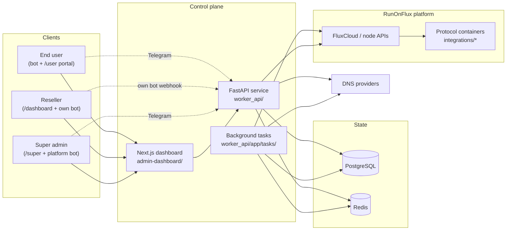
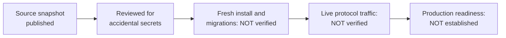

# RunOnFlux VPN Control Plane

[](https://runonflux.com/)
[](docs/FEATURES.md)
[](worker_api/)
[](admin-dashboard/)
[](worker_api/pyproject.toml)
[](LICENSE)

An **independent, multi-protocol VPN control plane** for the
[RunOnFlux](https://runonflux.com/) / FluxCloud platform. It combines a reseller and
admin web dashboard, a control-plane API, Telegram bot front-ends, and containerized
protocol nodes behind a shared credential and billing model.

> **Not affiliated.** This is an independent project. It is not an official RunOnFlux
> product and does not imply sponsorship, endorsement, partnership or affiliation.
> RunOnFlux and FluxCloud are names of the platform this integration targets.

> **Experimental.** See [Project status](#project-status) and
> [docs/FEATURES.md](docs/FEATURES.md). No installation, upgrade, or live-traffic
> verification has been performed for this snapshot.

## Contents

- [What this is](#what-this-is)
- [Capabilities at a glance](#capabilities-at-a-glance)
- [Architecture at a glance](#architecture-at-a-glance)
- [Repository layout](#repository-layout)
- [Quick start](#quick-start)
- [Documentation](#documentation)
- [Project status](#project-status)
- [Security](#security)
- [Contributing](#contributing)
- [Licensing and rights](#licensing-and-rights)

## What this is

The control plane models three actors and the relationships between them:

| Actor | Surface | Responsibility |
| --- | --- | --- |
| **Super admin** | `/super/*` dashboard routes, platform bot | Platform configuration, resellers, wire top-ups, TLD/DNS management, Flux apps |
| **Reseller (admin)** | `/dashboard/*` routes, own Telegram bot | Packages, orders, own end users, wallet, referral program |
| **End user** | Reseller bot, `/user/*` portal routes | Purchases, connections, usage, settings |

Around those actors the backend owns subscription lifecycle, credential issuance,
usage accounting, wallet/ledger bookkeeping, routing rules, DNS/TLD automation,
protocol node discovery through RunOnFlux, and notification/broadcast delivery.

Protocol delivery is delegated to upstream engines packaged as separate container
images: SSH, Shadowsocks, Outline, Trojan, V2Ray and an HTTP proxy. The control plane
ships credentials and configuration to those nodes; it does not reimplement any
protocol.

## Capabilities at a glance

- Multi-protocol subscriptions with per-protocol credential issuance.
- Reseller hierarchy with wallet ledger, wire top-up approval and per-user limits.
- Direct and reseller-owned Telegram bots, including a bot-facing internal API.
- Free-config channels with enrollment, membership verification and policy rules.
- Referral codes and bonus accrual.
- Traffic accounting with per-day rollups, live connection views and telemetry ingest.
- DNS/TLD automation across multiple DNS providers with health and reachability checks.
- RunOnFlux application registration, instance discovery, health monitoring and
  node-level API operations.
- IP management and node autoscaling.
- Broadcasts plus notification templating in English and Persian.
- Support ticket flows, compliance tooling and audit-oriented logging.

The full catalogue — with a maturity rating per capability — is in
[docs/FEATURES.md](docs/FEATURES.md).

## Architecture at a glance



Full diagrams (container, component, data model and request flows) live in
[docs/ARCHITECTURE.md](docs/ARCHITECTURE.md).

## Repository layout

| Path | Contents |
| --- | --- |
| [`worker_api/`](worker_api/) | FastAPI application, models, migrations, background tasks and tests |
| [`admin-dashboard/`](admin-dashboard/) | Next.js admin/reseller/user interfaces and the API client |
| [`telegram_bot/`](telegram_bot/) | Standalone bot process with handlers, keyboards and i18n |
| [`integrations/`](integrations/) | Per-protocol container build files and shared bootstrap helpers |
| [`docs/`](docs/README.md) | Architecture, capability, developer and operator documentation |
| [`scripts/`](scripts/test.sh) | Development and test entry points |

## Quick start

> Source inspection and disposable local testing only. This is not a deployment guide —
> see [docs/DEPLOYMENT.md](docs/DEPLOYMENT.md).

```bash
git clone https://github.com/SireJeff/runonflux-vpn-control-plane.git
cd runonflux-vpn-control-plane

# Backend: service-free checks that use no database or external service
cd worker_api
python -m pytest --confcutdir=tests/safety tests/safety -q -o addopts=""
```

A disposable PostgreSQL/Redis stack for the broader backend suite requires a trusted
**local** Docker daemon with Compose v2:

```bash
bash scripts/test.sh
```

Configuration is supplied through environment variables. Start from
[`.env.example`](.env.example) and generate your own values; the file contains empty
placeholders by design and is not a production template. See
[docs/CONFIGURATION.md](docs/CONFIGURATION.md).

Dashboard development requires Node.js and a separate dependency install:

```bash
cd admin-dashboard
npm ci
npm run dev      # http://localhost:3000
npm run check:guides
```

## Documentation

Start at the [documentation index](docs/README.md).

| Document | For |
| --- | --- |
| [Architecture](docs/ARCHITECTURE.md) | System context, containers, components and flows |
| [Capabilities](docs/FEATURES.md) | What each subsystem does, and how mature it is |
| [Security model](docs/SECURITY-MODEL.md) | Trust boundaries and credential handling |
| [Development](docs/DEVELOPMENT.md) | Environment setup, quality gates, conventions |
| [Configuration](docs/CONFIGURATION.md) | Environment variables and required values |
| [API](docs/API.md) | Endpoint groups and role requirements |
| [Testing](docs/TESTING.md) | Test layers and isolation rules |
| [Deployment](docs/DEPLOYMENT.md) | What is *not* provided, and what to check first |
| [Super-admin guide](docs/platform/SUPERADMIN_GUIDE.md) | Platform operation through the dashboard and bot |
| [Reseller guide](docs/platform/SUBADMIN_GUIDE.md) | Reseller operation end to end |
| [Glossary](docs/GLOSSARY.md) | Terms used across the documents |
| [Third-party review](THIRD_PARTY_REVIEW.md) | Dependency and notice inventory |
| [Changelog](CHANGELOG.md) | Public snapshot history |

## Project status



- The snapshot is a curated source export; it is not built from a tagged release.
- No dependency install, database migration, image build or live traffic test has been
  run for this snapshot.
- Protocol engines are upstream software packaged here; their own behaviour and
  licensing obligations are separate.
- Rights, contribution provenance and notice obligations remain unresolved — see
  [Licensing and rights](#licensing-and-rights).

## Security

Do not deploy this snapshot for real users, funds or data without an independent
review. Credential revocation for the operational system this snapshot was derived
from has **not** been established here. See [SECURITY.md](SECURITY.md) for the
security model summary and how to report a problem privately.

## Contributing

Issues and pull requests are welcome. Read [CONTRIBUTING.md](CONTRIBUTING.md) first —
it covers environment setup, the required quality gates, the documentation gate and
what a reviewable change looks like. Participation is covered by the
[Code of Conduct](CODE_OF_CONDUCT.md). Questions belong in
[SUPPORT.md](SUPPORT.md).

## Licensing and rights

`LICENSE` is preserved verbatim from the source baseline and contains an existing
dedication with custom wording. **No new licence is applied by this repository, and
publication is not legal clearance.** Ownership, prior grants, contributor agreements,
upstream/copy-derived source and redistribution obligations still require resolution
before any redistribution you intend to rely on. See
[THIRD_PARTY_REVIEW.md](THIRD_PARTY_REVIEW.md) and [LICENSES/](LICENSES/) for the
inventory aids.

`SOURCE_MANIFEST.json` records the source revision, per-file output hashes and
transform counts for this snapshot. It is provenance evidence, not a security or legal
certificate.
