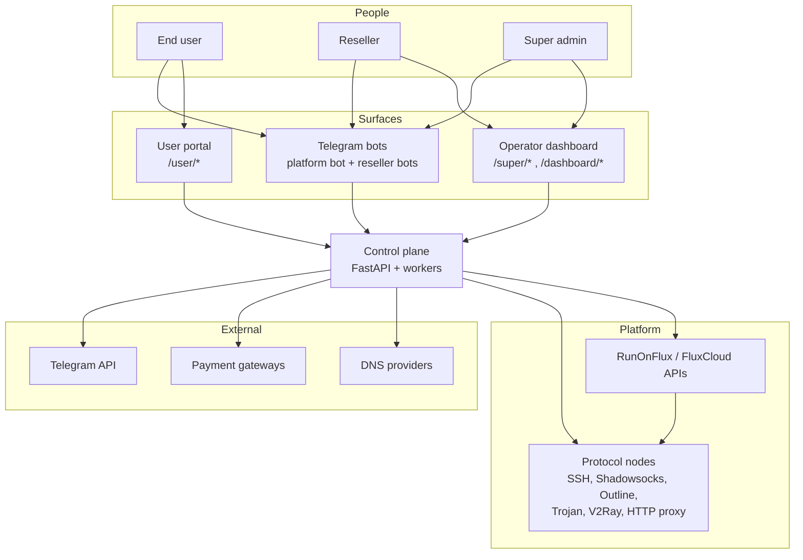
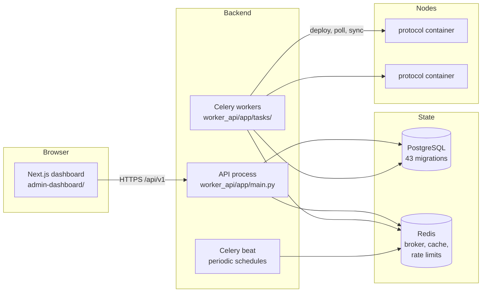
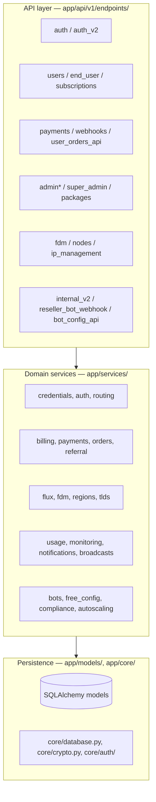
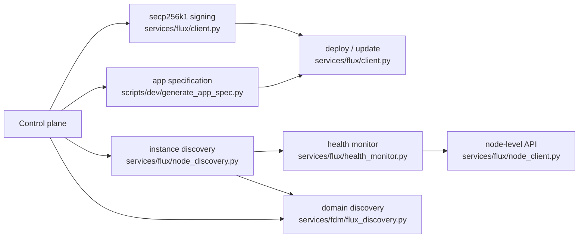
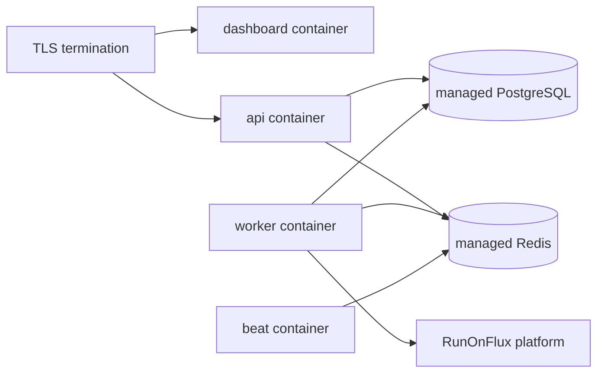

# Architecture overview

This is the map. Detail lives in the linked documents; each one is self-contained so you
can read only the part you need.

## System context

The control plane sits between three kinds of human actor, two delivery surfaces, and
the infrastructure that actually carries traffic.

**Reading the diagram:** only the control plane talks to the platform, DNS and payment
providers. End users never receive platform credentials; they receive protocol
credentials issued by the control plane.

## Containers

| Container | Source | Responsibility |
| --- | --- | --- |
| Dashboard | [`admin-dashboard/`](../admin-dashboard/) | Server-rendered UI, client components, API proxying, in-app help |
| API | [`worker_api/`](../worker_api/) | REST surface under `/api/v1`, schema migrations, health endpoints |
| Workers | [`worker_api/app/tasks/`](../worker_api/app/tasks/) | Billing, provisioning, DNS sync, telemetry, notifications |
| Protocol nodes | [`integrations/`](../integrations/) | Upstream VPN engines with a shared bootstrap contract |
| Bot | [`telegram_bot/`](../telegram_bot/) | Standalone Telegram process used by operators |

## Component view of the API

Routers should stay thin: validate, authorise, delegate. Business rules belong in the
service modules, and anything that must be repeatable or slow belongs in a task.

Full detail: [backend](architecture/backend.md) ·
[dashboard](architecture/dashboard.md) ·
[integrations](architecture/integrations.md).

## RunOnFlux integration surface

Detail, including the authentication chain and resilience settings:
[RunOnFlux platform integration](architecture/flux-platform.md).

## Cross-cutting concerns

| Concern | Where it lives | Notes |
| --- | --- | --- |
| Configuration | [`worker_api/app/core/config.py`](../worker_api/app/core/config.py) | Pydantic settings loaded from the environment; see [CONFIGURATION.md](CONFIGURATION.md) |
| Authentication | [`worker_api/app/core/auth/`](../worker_api/app/core/auth/) | JWT issuance/verification, password hashing, role dependencies |
| Session transport | [`worker_api/app/core/security.py`](../worker_api/app/core/security.py) | JWT bearer auth plus an internal service key |
| Secret encryption | [`worker_api/app/core/crypto.py`](../worker_api/app/core/crypto.py) | AES-GCM at rest for stored bot tokens |
| Data access | [`worker_api/app/core/database.py`](../worker_api/app/core/database.py) | Engine/session factory with per-session Postgres guards |
| Caching and limits | [`worker_api/app/core/redis_client.py`](../worker_api/app/core/redis_client.py) | Optional Redis-backed client |
| Scheduling | [`worker_api/app/core/celery_config.py`](../worker_api/app/core/celery_config.py) | Celery app, queues and periodic schedules |
| Migrations | [`worker_api/alembic/`](../worker_api/alembic/) | Linear Alembic history, applied by `start.sh` |
| Observability | [`worker_api/app/services/monitoring/`](../worker_api/app/services/monitoring/) | Metrics plus optional Sentry |

## Deployment topology (conceptual)

This shows the intended shape only. No deployment automation, reverse-proxy
configuration, TLS setup, secret manager integration or backup policy is included in
this snapshot. See [DEPLOYMENT.md](DEPLOYMENT.md).

## What these diagrams deliberately omit

- **No infrastructure values.** Addresses, domains, node identifiers and credentials are
  omitted; placeholders are synthetic.
- **No runtime guarantees.** Relationships are derived from source, not from observing a
  running system.
- **No exact endpoint inventory.** The [API](API.md) document describes groups and roles;
  the code is the authority for individual routes.

## Where to go next

- New to the codebase: [Development](DEVELOPMENT.md), then [backend](architecture/backend.md).
- Evaluating fitness: [Capabilities](FEATURES.md), then [Deployment](DEPLOYMENT.md).
- Threat modelling: [Security model](SECURITY-MODEL.md).
- Explaining a behaviour: [Request flows](architecture/request-flows.md).