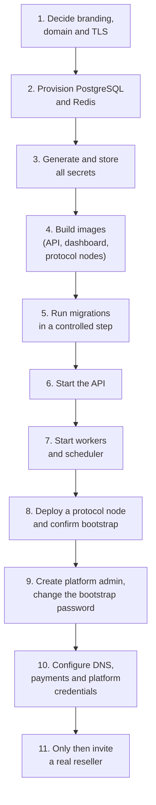

# Deployment

**This document does not tell you how to deploy. It tells you what is missing, so you can
decide what to build.**

This snapshot contains application source and per-protocol container build files. It
deliberately contains **no** deployment automation, no production compose file, no
reverse-proxy configuration, no secret provisioning and no operational runbooks. Those
belong to whoever operates the service.

## What you must supply yourself

| Area | Not provided | You need to decide |
| --- | --- | --- |
| Orchestration | No production compose/manifest, no provisioning scripts | How containers are placed and restarted |
| TLS and ingress | No certificates, no proxy configuration | Termination, HSTS, redirect rules |
| Secrets | No secret manager integration | Where secrets live and who can read them |
| Database | No managed instance, no backup or PITR plan | Sizing, backups, restore drills |
| Redis | No persistence or failure policy | Eviction, availability |
| Migrations | Only `alembic upgrade head` at container start | How you handle a failed migration mid-upgrade |
| Observability | In-process metrics only | Dashboards, alerting, on-call |
| Node provisioning | No images published by this repo | Registry, tagging, digest pinning |
| Platform account | Nothing for RunOnFlux | Wallet, application registration, capacity |
| Payments | No gateway accounts | Which gateways, compliance, chargebacks |
| DNS | No accounts or zones | Providers, token scoping, propagation policy |
| Legal | Nothing | Terms, privacy notice, lawful basis, licensing |

## Order of operations

The dependencies between pieces are real, not stylistic:

Two steps deserve emphasis:

- **Do not let migration and startup be your only migration strategy.** The container runs
  `alembic upgrade head` at boot, which is convenient locally and risky in production: a
  failed migration leaves you with a half-started service. Run migrations as their own
  controlled step with a verified backup.
- **Verify one node before scaling.** A node that cannot bootstrap must not serve traffic;
  a fleet of misconfigured nodes is worse than none.

## Pre-flight checklist

- [ ] Independent security review of this code, or an explicit accepted risk.
- [ ] Every secret generated independently; none copied from examples.
- [ ] `DEBUG` disabled; interactive API documentation unreachable.
- [ ] `ALLOWED_ORIGINS` restricted to your real dashboard origins.
- [ ] Database and Redis reachable only from the application network.
- [ ] Backups configured **and a restore actually tested**.
- [ ] Rate limits reviewed for your expected traffic.
- [ ] Payment gateway webhook verification confirmed against current provider docs.
- [ ] DNS tokens scoped to the zones you manage.
- [ ] Telegram webhook secret set and verified.
- [ ] Retention policy decided for traffic data and support conversations.
- [ ] A rollback plan for a failed migration and for a bad deploy.
- [ ] Known credential exposure in your environment rotated — see
      [SECURITY-MODEL.md](SECURITY-MODEL.md).
- [ ] Licensing and notice obligations resolved for anything you redistribute —
      see [THIRD_PARTY_REVIEW.md](../THIRD_PARTY_REVIEW.md).

## What "verified" must mean before real users

The following are unverified in this snapshot and should be demonstrated in *your*
environment before carrying real traffic:

1. A fresh install from empty state to a serving API.
2. A fresh database created purely by migrations, plus a rehearsal of an upgrade.
3. A dashboard production build that renders correctly, including Persian RTL pages.
4. One protocol node bootstrapping, syncing users, reporting usage, and carrying real
   traffic end to end.
5. A subscription purchase flowing to a working connection.
6. A wallet top-up, approval and debit appearing correctly in the ledger.
7. A payment gateway round trip in sandbox mode, including webhook verification.
8. A DNS record created, verified and cleaned up by the automation.
9. A restart of each process with in-flight work, showing no duplicate effects.
10. A backup restored into a scratch environment.

## Scaling and operations notes

- Workers are the correct place for slow provider work; do not bypass them from request
  paths to "make it faster".
- Shared DNS provider rate limits mean sync must stay convergent: rewriting every record
  each cycle exhausts the budget and stalls provisioning.
- Telemetry correctness is a billing concern. A node that stops reporting is a revenue
  and fairness problem, not just a monitoring gap.
- Autoscaling coordinates through Redis; a split or flushing Redis will confuse it.

## Explicit non-claims

- Nothing in this repository has been installed, migrated, built or load-tested.
- No protocol traffic has been carried by any code path described here.
- No support, uptime or correctness guarantee is offered.
- Publishing this source does not revoke anything: any credential that ever existed in an
  operational deployment must be rotated by its owner.

## Related documents

- [CONFIGURATION.md](CONFIGURATION.md) — every setting you must supply
- [SECURITY-MODEL.md](SECURITY-MODEL.md) — threat boundaries and hardening checklist
- [FEATURES.md](FEATURES.md) — what is implemented versus unproven
- [architecture/integrations.md](architecture/integrations.md) — node contract and build
- [SUPPORT.md](../SUPPORT.md) — what this project cannot help with