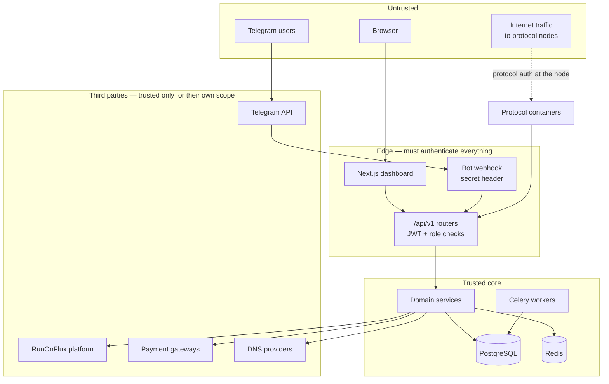

# Security model

A map of trust boundaries and secret handling, so reviewers and operators know what the
code assumes. It deliberately describes **classes** of control, not exploitation detail.

> This is a design summary, not an audit. No penetration test or dependency review has
> been performed. Report problems privately per [../SECURITY.md](../SECURITY.md).

## Trust boundaries

## Actor isolation

| Boundary | Enforcement |
| --- | --- |
| End user ↔ reseller | Role claim plus ownership checks on the user record |
| Reseller ↔ reseller | Every reseller-scoped query is bounded to the caller's own `Admin` |
| Reseller ↔ platform | Platform endpoints require the `super_admin` role; reseller tokens must not reach them |
| Machine callers | Internal endpoints require the internal API key, not a user token |
| Node callers | Deployment tokens with a short expiry, verified before bootstrap |

The rules that keep this honest: never trust an identifier from the request body when the
token already determines the principal, and never widen a query "because the UI already
filtered".

## Secret classes

| Secret | Stored where | Rotation reality |
| --- | --- | --- |
| `JWT_SECRET_KEY` | Environment only | Rotating invalidates every issued session |
| `FLUXVPN_SECRET_KEY` | Environment only | Derives the encryption key for stored bot tokens: rotation requires re-encryption |
| `INTERNAL_API_KEY` | Environment plus node configuration | Distributed; rotate on every node and the bot process together |
| `FLUX_WALLET_PRIVATE_KEY` | Environment only | Wallet authority; rotation means a new wallet identity |
| Payment gateway keys | Environment only | Rotate at the provider, then update configuration |
| DNS API tokens | Environment / platform settings | Rotate at the provider; scope tokens to the smallest zone set |
| Telegram bot tokens | Encrypted at rest per reseller | Re-register through the dashboard |
| User passwords | bcrypt hash | Reset, never recoverable |
| Subscription credentials | Derived per subscription | Reissue rather than edit history |

Two consequences worth repeating:

- **`FLUXVPN_SECRET_KEY` is not a drop-in config change.** It derives the AES-GCM key for
  stored bot tokens; changing it silently breaks decryption.
- **Publishing source does not revoke anything.** Anything ever exposed in an operational
  deployment must be rotated by its owner.

## Data at rest

- Stored bot tokens are encrypted with AES-GCM; the blob is `nonce || ciphertext || tag`
  and the key is derived from configuration.
- Passwords are bcrypt-hashed and never returned.
- Everything else — orders, traffic, wallets, support conversations — is stored in clear
  text in the database. **Database-level encryption, access control and audit logging are
  your responsibility**, not something this repository provides.

## Data in transit

- The application assumes it sits behind TLS terminated by your own proxy; nothing here
  configures certificates.
- CORS is configured from an explicit origin list. Do not set it to a wildcard in a
  deployment that carries credentials.
- Inter-service calls (dashboard to API, node to API) must stay on a trusted network or
  behind TLS.

## Authentication specifics

- JWT access and refresh tokens carry a role claim; the role is re-resolved against the
  database on each request rather than trusted from the token alone.
- Rate limiting is Redis-backed and per-window; it is a brake, not a security control.
- Bot webhook requests are accepted only with the expected secret header, compared in a
  timing-safe way. The secret is per bot registration.
- Admin-issued password resets are the recovery path; there is no self-service email
  reset wired up in this snapshot.

## What an attacker can learn from this repository

Assume the source is public — it is. Therefore:

- Do not rely on obscurity for any endpoint path or parameter name.
- Never commit a real deployment's hostnames, internal addresses or identifiers; that is
  why this snapshot carries synthetic examples.
- A configuration file in your deployment is the only thing separating your instance from
  a reader of this code.

## Known weaknesses and accepted risks

| Item | Status |
| --- | --- |
| No container hardening (read-only root, capability drops, seccomp) | Not implemented |
| No WAF, bot detection or IP reputation | Not implemented |
| No per-endpoint audit log for read operations | Partial (metrics and logs exist) |
| No dependency vulnerability scanning in this repository | Not implemented |
| No secret-scanning promise beyond repository preparation | Recommended: enable provider-side scanning |
| Persian/RTL content not reviewed for injection in message templates | Unverified |
| Rate-limit coverage not measured under load | Unverified |

## Hardening checklist for an operator

1. Terminate TLS yourself and force HTTPS.
2. Generate every secret independently; never reuse an example value.
3. Restrict database and Redis network access to the application only.
4. Scope DNS tokens to the zones you actually manage.
5. Set `ALLOWED_ORIGINS` to your exact dashboard origins.
6. Keep `DEBUG` off in any environment reachable from the internet; it enables interactive
   API documentation at `/api/docs`.
7. Run the disposable test stack only against a local Docker daemon.
8. Review the payment gateways' webhook verification against their current documentation.
9. Decide and document your retention policy for traffic and support data.
10. Rotate every credential that ever lived in source, logs or screenshots.