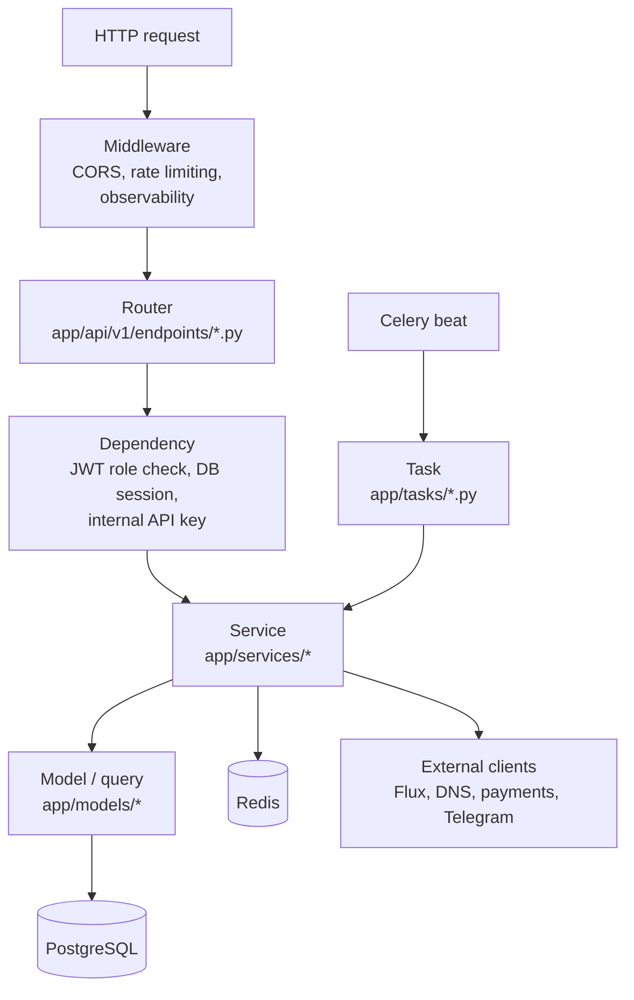
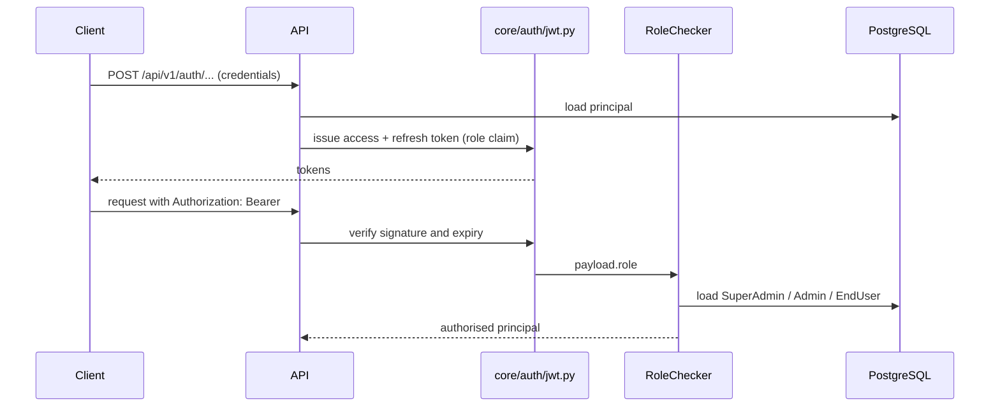

# Backend architecture

The backend is a FastAPI application with a conventional three-layer split: HTTP
routers, domain services, and persistence. Background work runs in Celery workers that
share the same service and model code.

## Layering

Rules the codebase tries to follow:

- **Routers do not hold business rules.** They validate input, resolve the caller's role,
  and delegate.
- **Services own invariants.** Money movement, credential issuance and state transitions
  go through service functions so tasks and endpoints behave identically.
- **Anything slow or periodic is a task.** Providers, DNS and telemetry work must not
  block a request.

## Entry point

[`worker_api/app/main.py`](../../worker_api/app/main.py) creates the FastAPI application,
registers CORS and middleware, mounts every router under `/api/v1`, and exposes
health/metrics endpoints. Interactive API documentation is enabled only in debug mode
(`/api/docs`, `/api/redoc`).

[`worker_api/start.sh`](../../worker_api/start.sh) is the container entry point: it verifies
critical imports, waits for the database, applies `alembic upgrade head`, then starts
uvicorn. A failed migration aborts startup rather than serving a stale schema.

## API surface

Routers are grouped by the caller they serve. The full module list lives in
[`app/api/v1/endpoints/`](../../worker_api/app/api/v1/endpoints/).

| Group | Modules | Caller |
| --- | --- | --- |
| Authentication | `auth`, `auth_v2`, `migrate` | All roles |
| End user | `end_user`, `users`, `subscriptions`, `credentials`, `user_orders_api` | End user |
| Money | `payments`, `webhooks`, `support` | End user and gateways |
| Reseller | `admin`, `admin_api`, `admin_dashboard`, `admin_packages_api`, `bot_config_api`, `broadcast_api`, `free_config_api`, `routing_rules_api`, `referral_api`, `ip_management`, `nodes` | Reseller |
| Platform | `super_admin`, `super_admin_bots_api`, `free_config_global_api`, `broadcast_api.superadmin_router`, `fdm` | Super admin |
| Machine | `internal_v2`, `reseller_bot_webhook` | Bots and internal callers |
| Misc | `mvp` | Public/experimental paths |

Endpoint groups and their role requirements are summarised in [../API.md](../API.md).

## Service domains

| Domain | Directory | Owns |
| --- | --- | --- |
| Authentication | `services/auth` | Deployment tokens for node callbacks |
| Credentials | `services/credentials` | Username generation, credential lifecycle, connection strings, routing presets |
| Billing | `services/billing` | Wallet ledger, traffic and region billing, wire orders, conversion, top-up policy |
| Payments | `services/payments` | Stripe, NOWPayments and Zarinpal adapters |
| Orders | `services/orders` | Order lifecycle and receipt storage |
| Subscriptions | `services/subscriptions` | Renewal, adjustments, package seeding |
| Referral | `services/referral` | Codes and bonus accrual |
| Free config | `services/free_config` | Channel policy, enrollment, membership verification, global limits |
| Routing | `services/routing` | Routing rule evaluation |
| Regions | `services/regions` | Availability and assignment |
| TLDs / DNS | `services/tlds`, `services/fdm` | Domain selection, proxy routes, DNS providers, sync, liveness, reachability |
| RunOnFlux | `services/flux` | API client, authentication, discovery, health, consensus, resilience |
| Usage | `services/usage` | Metric adapters, live connections, aggregation |
| Monitoring | `services/monitoring` | Health and performance metrics |
| Notifications | `services/notifications` | Templated messages (English/Persian), delivery, alerting |
| Broadcasts | `services/broadcasts` | Bulk message campaigns and staleness rules |
| Bots | `services/bots` | Reseller-bot lifecycle, end-user conversation flows, keyboards, catalogues |
| Compliance | `services/compliance` | User deletion and retention |
| Autoscaling | `services/autoscaling` | Capacity decisions |

## Background tasks

[`worker_api/app/tasks/`](../../worker_api/app/tasks/) contains the schedulable work.
Schedules are declared in [`core/celery_config.py`](../../worker_api/app/core/celery_config.py).

| Task module | Work |
| --- | --- |
| `billing_tasks` | Ledger, charging and reconciliation passes |
| `subscription_tasks` | Expiry, renewal and state transitions |
| `fdm_tasks` | DNS/TLD sync, liveness, reachability checks |
| `flux_tasks` | Platform polling, deployment follow-up, registration upkeep |
| `node_tasks` | Node inventory and node-level operations |
| `ip_tasks` | IP pool maintenance |
| `usage_tasks` | Traffic ingestion and rollups |
| `tld_analytics` | Per-TLD daily analytics |
| `free_config_tasks` | Enrollment and membership refresh |
| `broadcast_tasks` | Broadcast dispatch and staleness |
| `end_user_notifications` | User-facing notifications |
| `compliance_tasks` | Retention and deletion work |

Tasks reuse the service layer; they do not duplicate business rules. Anything that
mutates money or credentials must be idempotent, because Celery can retry.

## Authentication and roles

- Roles are `super_admin`, `admin` (reseller) and `end_user`, enforced by
  [`core/auth/role_dependencies.py`](../../worker_api/app/core/auth/role_dependencies.py).
- Passwords are hashed with bcrypt in
  [`core/auth/password.py`](../../worker_api/app/core/auth/password.py).
- Tokens are signed JWTs (`core/auth/jwt.py`); expiry is configuration-driven.
- Service-to-service calls use an internal API key checked in
  [`core/security.py`](../../worker_api/app/core/security.py), not a user token.
- Node callbacks use deployment tokens with their own expiry
  (`services/auth/deployment_tokens.py`).

## Data access

- SQLAlchemy models live in [`app/models/`](../../worker_api/app/models/) and are the single
  source of truth for the schema.
- [`core/database.py`](../../worker_api/app/core/database.py) builds the engine and session
  factory; Postgres sessions receive lock and statement timeouts so a stuck request
  cannot hold a row indefinitely.
- Migrations are linear and applied at startup. Never edit an applied migration; add a
  new revision.

## Encryption of stored secrets

[`core/crypto.py`](../../worker_api/app/core/crypto.py) encrypts sensitive stored values
with AES-GCM. The key is derived from `FLUXVPN_SECRET_KEY`; the stored blob is
`nonce || ciphertext || tag`.

Consequences worth knowing before you change configuration:

- Rotating `FLUXVPN_SECRET_KEY` makes existing encrypted values unreadable. Plan a
  re-encryption or re-issuance path first.
- Because the key is derived, changing the derivation also breaks decryption.
- The same secret may also back derived identifiers elsewhere; treat rotation as a
  migration, not a config edit.

## Error handling and observability

- Failures are returned as structured HTTP errors; unhandled exceptions are logged
  without echoing secrets.
- Rate limiting is Redis-backed and configurable per window.
- Metrics are collected by `services/monitoring`; optional Sentry reporting is
  configured through `SENTRY_DSN`.

## What this layer does not guarantee

- No load, soak or concurrency testing has been recorded for this snapshot.
- Migration order has never been executed against a fresh database in this repository.
- External provider behaviour (Flux, DNS, payment gateways) is unverified here.

See [../TESTING.md](../TESTING.md) for what is actually executed, and
[../DEPLOYMENT.md](../DEPLOYMENT.md) for the gaps.