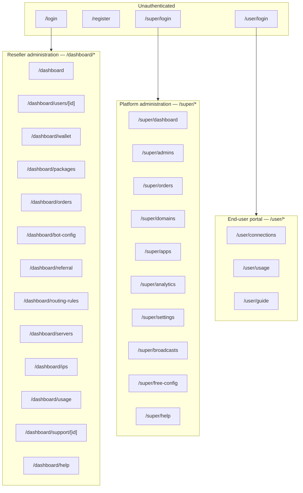
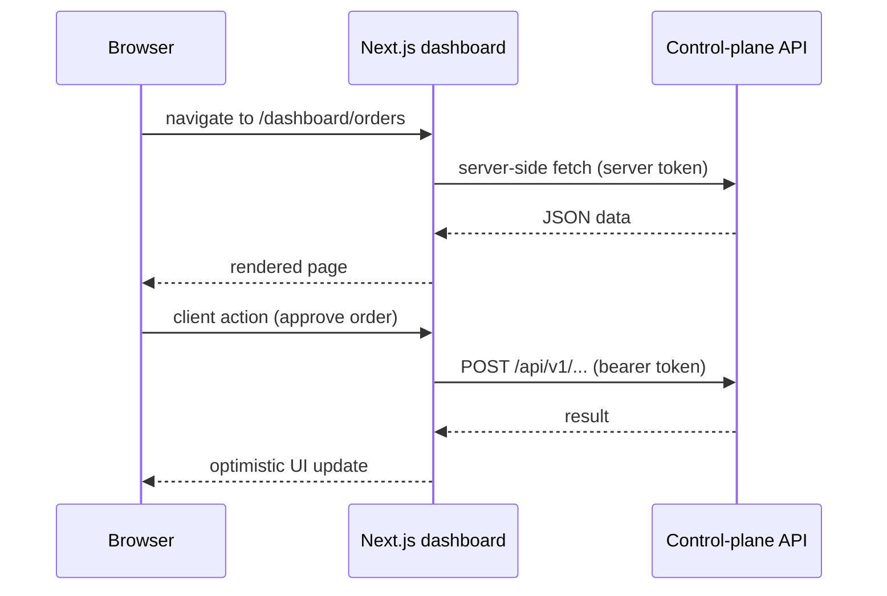
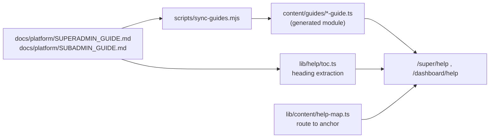

# Dashboard architecture

The dashboard is a Next.js application with three surfaces that share one API client:
platform administration (`/super/*`), reseller administration (`/dashboard/*`), and the
end-user portal (`/user/*`).

## Route map

Route groups in [`admin-dashboard/app/`](../../admin-dashboard/app/):

| Directory | Surface |
| --- | --- |
| `super/` | Platform administration, including domains, Flux apps, admins and analytics |
| `dashboard/` | Reseller administration: users, wallet, packages, orders, bot config, referral, routing rules, servers, IPs, usage, support, logs, broadcasts, free-config |
| `user/` | End-user portal: connections, usage and client setup guides |
| `login/`, `register/`, `super/login/`, `user/login/` | Entry points |
| `api/health/` | Liveness endpoint for the dashboard container |

## Request path

- Data fetching and endpoint wrappers live in
  [`admin-dashboard/lib/api/`](../../admin-dashboard/lib/api/) — one module per domain,
  mirroring the backend's router groups. Components should call those wrappers rather
  than issuing ad-hoc requests.
- [`middleware.ts`](../../admin-dashboard/middleware.ts) handles routing concerns that must
  happen before a page renders.
- Browser-visible configuration must never contain a secret: anything prefixed
  `NEXT_PUBLIC_` is public by definition.

## In-app help pipeline

The help pages are generated from operator documentation, not authored twice.

Two rules follow from this and are enforced by the quality gates:

- **Headings are an interface.** `lib/content/help-map.ts` deep-links routes to heading
  anchors (for example `/dashboard/wallet` → `3-wallet--billing`). Renaming or
  renumbering a section breaks the in-app help link; the repository documentation
  review fails if an anchor disappears.
- **Generated modules are never hand-edited.** Edit the Markdown, then run
  `npm run sync:guides`. `npm run check:guides` fails when the two drift.

## Presentation and localisation

| Concern | Location |
| --- | --- |
| Shared components and navigation | [`admin-dashboard/components/`](../../admin-dashboard/components/) |
| Hooks | [`admin-dashboard/hooks/`](../../admin-dashboard/hooks/) |
| Formatting and conversions | [`admin-dashboard/lib/format/`](../../admin-dashboard/lib/format/) |
| API client and endpoint wrappers | [`admin-dashboard/lib/api/`](../../admin-dashboard/lib/api/) |
| Help index/anchor mapping | [`admin-dashboard/lib/content/`](../../admin-dashboard/lib/content/) |
| User-portal localisation (English/Persian) | [`admin-dashboard/lib/i18n/`](../../admin-dashboard/lib/i18n/) |
| Shared types | [`admin-dashboard/types/`](../../admin-dashboard/types/) |
| Styling baseline | [`tailwind.config.ts`](../../admin-dashboard/tailwind.config.ts), [`components.json`](../../admin-dashboard/components.json) |

Persian is a right-to-left language; localised surfaces must be checked in RTL, not
only in English.

## Testing

| Layer | Command | Notes |
| --- | --- | --- |
| Unit and component | `npm test` (Vitest) | Covers API wrappers, help mapping, TOC parsing, formatting |
| Type checking | `npm run type-check` | `tsc --noEmit` |
| Lint | `npm run lint` | Next.js ESLint configuration |
| End-to-end | `npm run test:e2e` (Playwright) | Requires a running application stack |
| Guide sync | `npm run check:guides` | Fails when generated modules drift |

Playwright end-to-end coverage depends on a live stack, which this snapshot does not
provide. Treat recorded E2E results as unverified for this repository — see
[../TESTING.md](../TESTING.md).

## Operational notes

- The dashboard container builds with [`admin-dashboard/Dockerfile`](../../admin-dashboard/Dockerfile);
  its build-time public URLs are arguments, so a build must not embed an operator's
  production domain accidentally.
- `.dockerignore` for the dashboard context excludes build output, dependencies and
  local environment files; keep it that way when adding assets.
- Client bundle size matters: import from the specific component module rather than a
  barrel file when adding UI primitives.

## Known gaps

- No production build of the dashboard has been produced for this snapshot.
- No accessibility audit has been performed.
- Framework and dependency versions are unpinned relative to upstream releases; see
  [`package.json`](../../admin-dashboard/package.json).