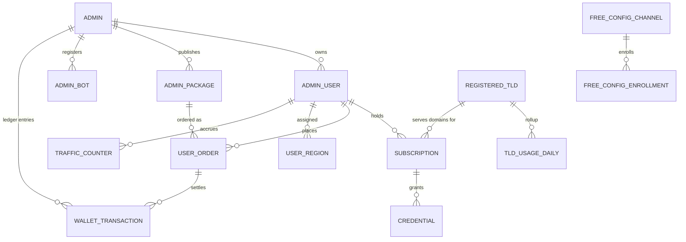
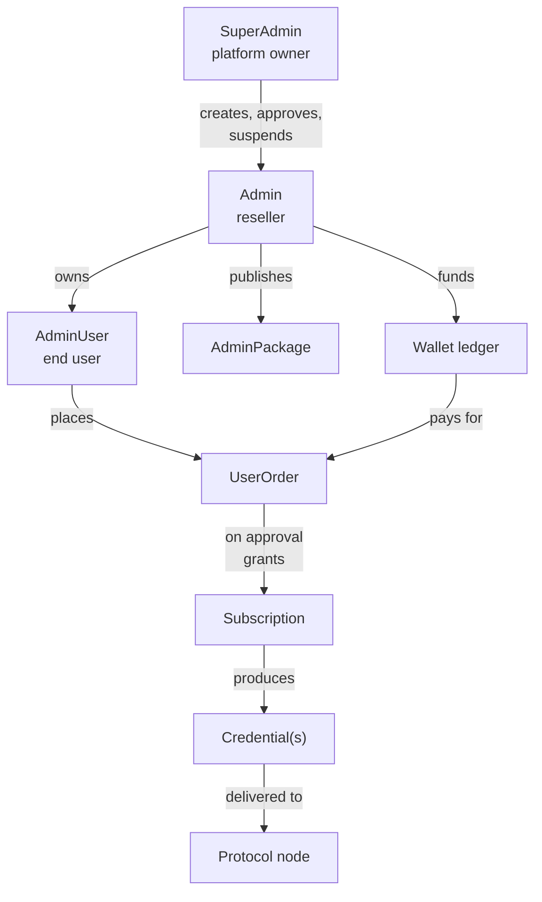
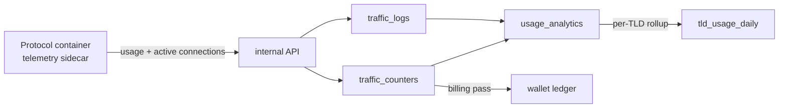

# Data model

The schema is defined by SQLAlchemy models in
[`worker_api/app/models/`](../../worker_api/app/models/) and evolved by the linear Alembic
history in [`worker_api/alembic/versions/`](../../worker_api/alembic/versions/) (43
revisions). **The models and migrations are authoritative**; this document groups them so
you can find your way around.

## Entity groups

| Group | Models |
| --- | --- |
| Actors and settings | `user`, `admins`, `admin`, `admin_users`, `platform_settings`, `settings` |
| Bots | `admin_bots` |
| Money | `wallet_transaction_v2`, `admin_user_wallet_txn`, `payment`, `user_orders`, `wire_orders`, `user_adjustments` |
| Subscriptions and catalogues | `subscription`, `admin_packages` |
| Credentials | `credential`, `user_credentials_v2` |
| Regions and routing | `user_regions`, `admin_routing_config` |
| IP pools | `ip_management`, `fdm_ip_liveness`, `fdm_ip_iran_reach` |
| Domains and DNS | `registered_tld`, `admin_tld_state`, `tld_usage_daily` |
| Platform applications | `flux_app_registration` |
| Free configuration | `free_config_channel`, `free_config_enrollment`, `free_config_global`, `admin_free_config` |
| Referral | `admin_referral` |
| Usage and traffic | `traffic_counters`, `traffic_logs`, `usage_analytics`, `usage_metrics` |
| Communications | `broadcast` |
| Operations | `logging`, `observability`, `ux` |

## Conceptual relationships

These relationships are conceptual, not a literal foreign-key diagram — read the models
for exact columns, constraints and cascade behaviour.

## The three actors, in schema terms

Note the naming trap: resellers are `Admin` records, while end users are `AdminUser`
records. `super_admin` is a role on the platform side, not a separate table.

## Money model in one paragraph

A reseller's wallet is a ledger, not a mutable balance: entries are written as
transactions and the balance is derived. Traffic and region charges debit the wallet;
wire top-ups credit it after a super admin approves them. End-user orders are paid
outside the platform (receipt or gateway) and recorded as orders, which a reseller
approves or rejects. Because the ledger is append-only in spirit, corrections are new
entries (`user_adjustments`), never silent edits.

## Usage accounting

Raw counters are attributable per user and protocol; rollups exist so dashboards do not
aggregate raw traffic at query time. Anything that charges money reads the same counters,
which is why telemetry correctness is a billing concern and not only an analytics one.

## Migration rules

- Migrations are applied by [`worker_api/start.sh`](../../worker_api/start.sh) on startup
  (`alembic upgrade head`); a failure aborts boot rather than serving a mismatched schema.
- Add a new revision; never rewrite an applied one.
- A migration that rewrites money, credentials or domains must be reversible in
  practice — plan the rollback before writing the `upgrade()`.
- Destructive operations (dropping columns, deleting rows) require a staged plan: add,
  dual-write, backfill, verify, then remove.

## Data-handling notes

- Personal data includes hierarchical identifiers, subscription history, traffic records
  and support conversations. Retention and deletion are handled by
  [`worker_api/app/services/compliance/`](../../worker_api/app/services/compliance/).
- Credentials are derived per subscription and can be rotated by reissuing rather than
  by rewriting history.
- Nothing in this repository is a data-processing agreement; operators are responsible
  for their own lawful basis and retention policy.

## Known gaps

- The schema has never been applied to a fresh database as part of preparing this
  snapshot, so migration ordering is unverified here.
- No ERD is generated from the live schema; the diagram above is maintained by hand and
  may lag the models.