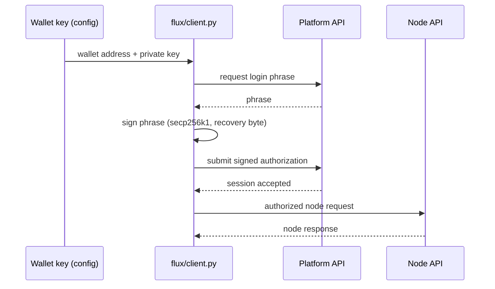
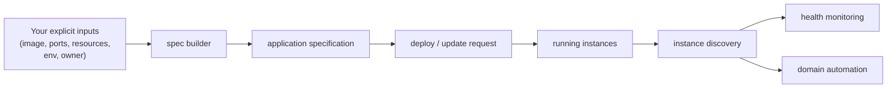

# RunOnFlux platform integration

The integration code lives in
[`worker_api/app/services/flux/`](../../worker_api/app/services/flux/) with a smaller
discovery client in [`worker_api/app/services/fdm/flux_discovery.py`](../../worker_api/app/services/fdm/flux_discovery.py).

This project is **independent**: it targets the RunOnFlux / FluxCloud APIs, but it is not
an official RunOnFlux component and implies no partnership or endorsement.

## What it does

| Concern | Module | Responsibility |
| --- | --- | --- |
| API client and authentication | [`flux/client.py`](../../worker_api/app/services/flux/client.py) | Application deployment and management requests, wallet-based authorization |
| Emergency/legacy path | [`flux/hybrid_client.py`](../../worker_api/app/services/flux/hybrid_client.py) | Alternative client used where the primary path is unavailable |
| User-supplied specifications | [`scripts/dev/generate_app_spec.py`](../../scripts/dev/generate_app_spec.py) | Builds an application specification from explicit input |
| Instance discovery | [`flux/node_discovery.py`](../../worker_api/app/services/flux/node_discovery.py) | Finds nodes and caches them |
| Node-level operations | [`flux/node_client.py`](../../worker_api/app/services/flux/node_client.py) | Per-node API calls, including authenticated write operations |
| Authentication primitives | [`flux/direct_node_auth.py`](../../worker_api/app/services/flux/direct_node_auth.py) | Produces node authorization material |
| Node lifecycle | [`flux/node_manager.py`](../../worker_api/app/services/flux/node_manager.py) | Selecting and maintaining usable nodes |
| Health monitoring | [`flux/health_monitor.py`](../../worker_api/app/services/flux/health_monitor.py) | Observes node health and records it |
| Multi-source agreement | [`flux/consensus_manager.py`](../../worker_api/app/services/flux/consensus_manager.py) | Cross-checks answers from multiple nodes before trusting one |
| Failure handling | [`flux/resilience.py`](../../worker_api/app/services/flux/resilience.py) | Retry policy and circuit breaking |
| Domain discovery | [`fdm/flux_discovery.py`](../../worker_api/app/services/fdm/flux_discovery.py) | Feed for DNS/domain automation |
| Scheduled work | [`tasks/flux_tasks.py`](../../worker_api/app/tasks/flux_tasks.py) | Polling, follow-up and registration upkeep |

## Authentication chain

Practical consequences:

- Authorization is a **wallet signature**, so the wallet key in configuration is
  equivalent to platform authority for the applications it owns. Treat it like a
  signing key, never a display value: it must not appear in logs, dashboards, issues or
  build arguments.
- Phrase expiry means the login flow repeats; the client refreshes rather than caching a
  long-lived token.
- Node-level write operations need their own authorization material, produced by
  `direct_node_auth.py`; a session that can deploy is not automatically able to address
  every node directly.

## Application specification and deployment

- Specifications are built from input you supply. Nothing in this repository contains a
  usable specification for someone else's deployment.
- Ports, container images and environment must be stated explicitly. The deployment code
  does not infer them, and it does not inject secrets for you.
- After deployment, discovery determines which instances actually exist, and health
  monitoring decides whether they are usable.

## Resilience and configuration

Behaviour is tunable through environment variables rather than hard-coded values,
including:

| Setting group | Purpose |
| --- | --- |
| `FLUX_API_URL` | Platform API base URL for your chosen endpoint |
| `FLUX_WALLET_ADDRESS`, `FLUX_WALLET_PRIVATE_KEY` | Authorization identity (empty in `.env.example`) |
| `FLUX_RETRY_*` | Retry attempts and backoff bounds |
| `FLUX_CIRCUIT_*` | Circuit-breaker failure threshold and recovery window |
| `FLUX_NODE_DISCOVERY_ENABLED`, `FLUX_NODE_CACHE_TTL_HOURS` | Discovery behaviour and cache lifetime |
| `FLUX_NODE_MIN_CONSENSUS`, `FLUX_NODE_API_PORT`, `FLUX_NODE_TIMEOUT` | Node selection policy and timeouts |
| `FLUX_INITIAL_NODES` | Bootstrap node list when discovery is unavailable |
| `FLUX_FDM_DISCOVERY_NODE_COUNT` | Discovery breadth used by domain automation |

Full variable list: [../CONFIGURATION.md](../CONFIGURATION.md).

Design rules worth preserving when you change this code:

- **Never bypass the resilience layer.** Direct calls lose retry, circuit breaking and
  consensus, and they will page on transient platform errors.
- **Consensus before trust.** Where multiple nodes can answer, disagreement is a signal,
  not a tie to break silently.
- **Idempotent deployment.** Re-running a deployment update must not create a second
  application or duplicate instances.

## How this differs from the protocol layer

The platform hosts protocol containers; it does not implement them. This integration's
job is to get the right container running on suitable nodes and to keep the control plane
informed. Protocol behaviour is described in
[integrations.md](integrations.md).

## Known gaps and honest limits

- No deployment has been performed against the live platform from this snapshot.
- Platform API compatibility is not pinned or verified; the platform may change and the
  integration may need to follow.
- Consensus thresholds and circuit-breaker values have not been load-tested here.
- Error taxonomy is generic: platform error strings are surfaced rather than mapped to a
  stable internal vocabulary.