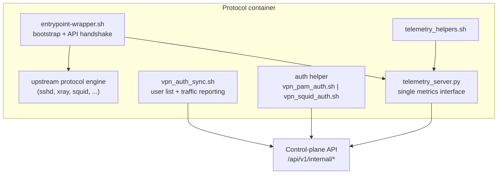
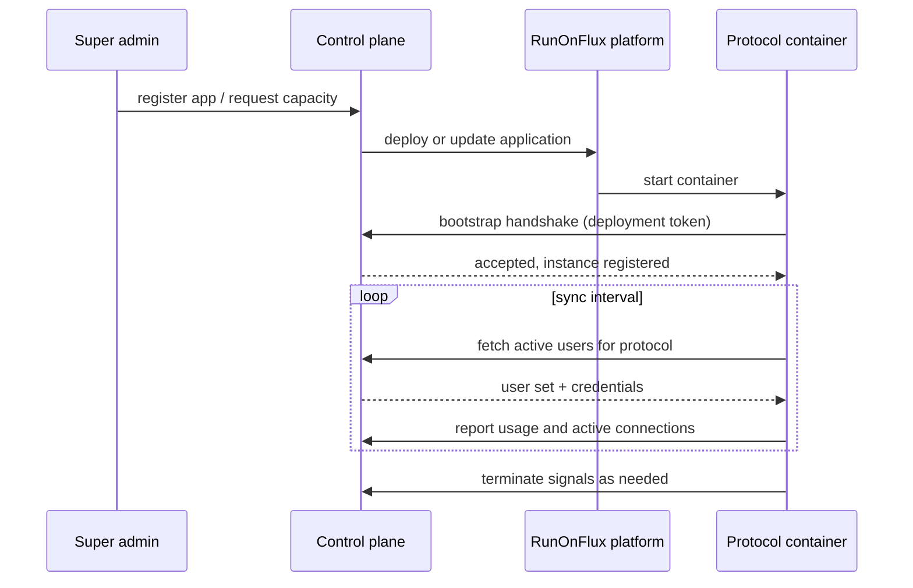

# Protocol integration architecture

Each protocol is a separate container image built from its own directory under
[`integrations/`](../../integrations/). The control plane never speaks a protocol; it ships
credentials and configuration to nodes and collects telemetry back.

> The protocol engines themselves are upstream software packaged here. Their own
> security posture and licence obligations are separate from this repository — see
> [../../THIRD_PARTY_REVIEW.md](../../THIRD_PARTY_REVIEW.md).

## Included protocols

| Directory | Protocol | Authentication path |
| --- | --- | --- |
| [`integrations/ssh/`](../../integrations/ssh/) | SSH | PAM helper validating each login against the API |
| [`integrations/shadowsocks/`](../../integrations/shadowsocks/) | Shadowsocks | User database synced periodically, with a config template |
| [`integrations/outline/`](../../integrations/outline/) | Outline | Managed access keys delivered through the API |
| [`integrations/trojan/`](../../integrations/trojan/) | Trojan | User list synced periodically |
| [`integrations/v2ray/`](../../integrations/v2ray/) | V2Ray (VLESS/VMess) | User list synced periodically |
| [`integrations/http-proxy/`](../../integrations/http-proxy/) | HTTP proxy (Squid) | Squid external ACL helper validating each request |

Shared bootstrap logic lives in [`integrations/base/`](../../integrations/base/) and is
copied into each protocol image at build time.

## Runtime contract



### Bootstrap

[`entrypoint-wrapper.sh`](../../integrations/base/entrypoint-wrapper.sh) validates the
container's deployment before starting the engine. It requires:

| Variable | Meaning |
| --- | --- |
| `FLUXVPN_AUTH_TOKEN` | Short-lived bootstrap token signed by the API |
| `FLUXVPN_API_URL` | API base URL for this deployment |
| `FLUXVPN_INSTANCE_ID` | Instance identifier issued at deployment time |

If the handshake fails the engine is not started, so a node never serves traffic it
cannot account for.

### Credential delivery

- [Periodic sync](../../integrations/base/vpn_auth_sync.sh) fetches the active user set for
  the container's protocol (`FLUXVPN_PROTOCOL`) and rewrites the protocol's own
  configuration. It also reports per-user traffic back to the API using
  `INTERNAL_API_KEY`.
- [Real-time helpers](../../integrations/base/vpn_pam_auth.sh) validate individual SSH
  logins through PAM, and
  [the Squid helper](../../integrations/base/vpn_squid_auth.sh) validates proxy
  credentials per request. Real-time validation is used where the engine supports
  hooking authentication; otherwise the sync path is authoritative.
- The matching server side lives in
  [`worker_api/app/api/v1/endpoints/internal_v2.py`](../../worker_api/app/api/v1/endpoints/internal_v2.py),
  which requires the `X-Internal-API-Key` header.

### Telemetry

[`telemetry_server.py`](../../integrations/base/telemetry_server.py) runs as a sidecar inside
each container and exposes one small HTTP interface regardless of protocol:

| Endpoint | Purpose |
| --- | --- |
| `GET /internal/usage` | Bandwidth usage records |
| `GET /internal/active-connections` | Per-user active connection counts |
| `POST /internal/terminate` | Signal that a user should be disconnected |

Protocol-specific scripts record counters through
[`telemetry_helpers.sh`](../../integrations/base/telemetry_helpers.sh). Keeping the
interface identical across protocols means usage accounting in
[`worker_api/app/services/usage/`](../../worker_api/app/services/usage/) does not need
per-protocol special cases.

## Lifecycle of a node



## Building a protocol image

```bash
cd integrations/<protocol>
docker build -t <local-tag> .
```

Notes and cautions:

- Each directory is self-contained and shares helpers by copying from `base` at build
  time; do not assume a shared parent image exists at runtime.
- Images inherit their base-image packages (for example OpenSSH, Squid, or the Xray
  distribution) with their own obligations and advisories. Review digests and notices
  before redistributing anything you build.
- Configuration templates are provided where the engine needs one (for example the
  Shadowsocks config template); real values come from the control plane, never from a
  committed file.
- No image in this snapshot has been built or run as part of preparing it.

## Isolation properties

- Containers authenticate to the API with an internal key and a per-deployment token,
  not with user credentials.
- The engine's own configuration is rewritten from the API's authoritative user set, so
  a stale container converges after the next sync.
- Telemetry is per-instance; a node that cannot report is visible to health monitoring
  rather than silently free.

## Known gaps

- Container hardening (read-only root filesystems, capability drops, seccomp profiles)
  is not included here.
- No protocol-level end-to-end test exists in this repository: nothing proves that a
  generated credential actually connects.
- Rate-limit and abuse controls live in the control plane, not in the containers.