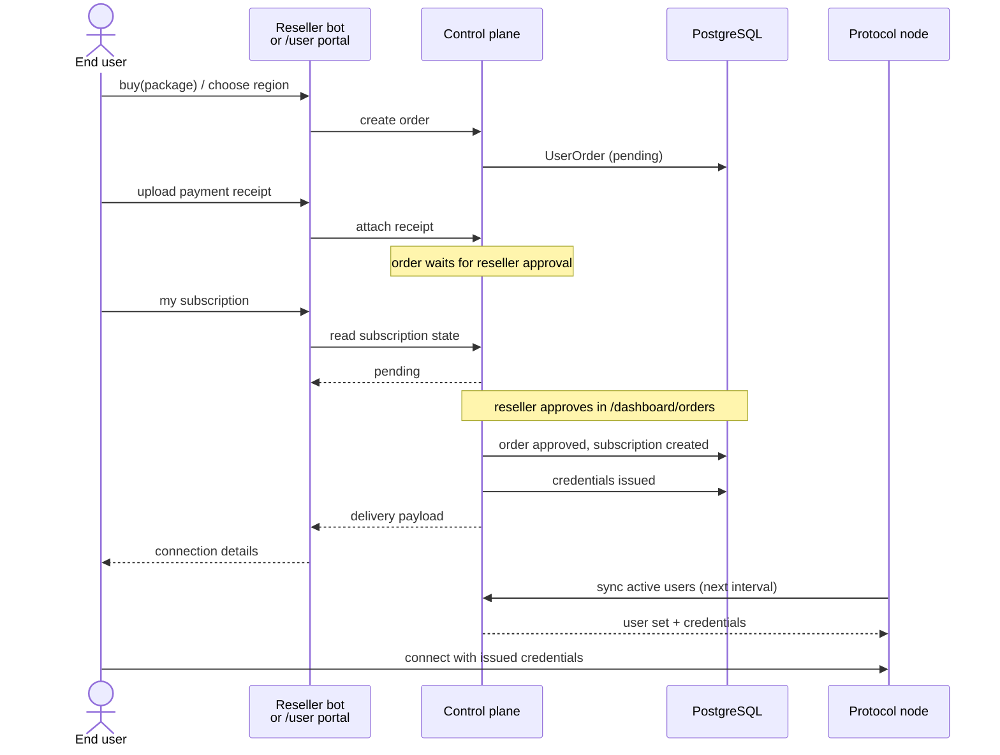
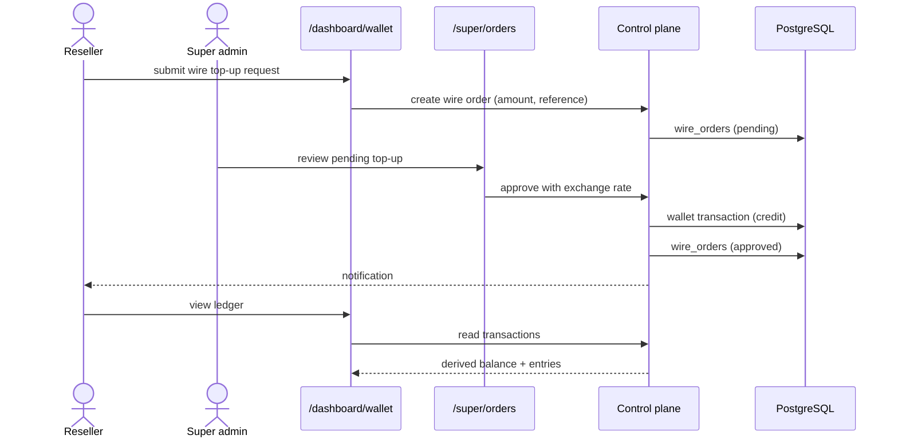
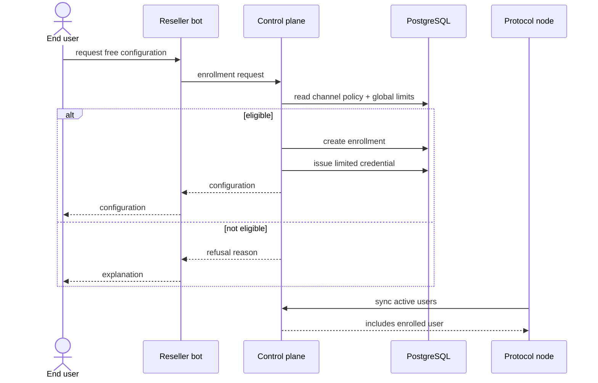
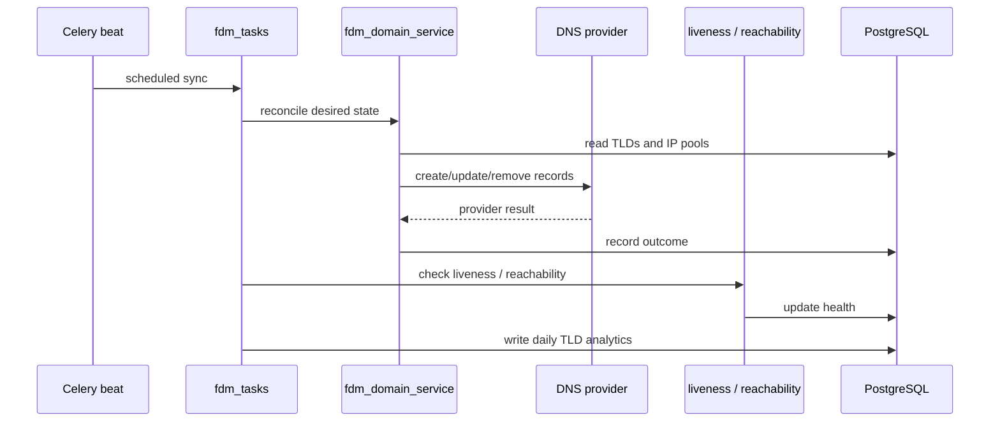
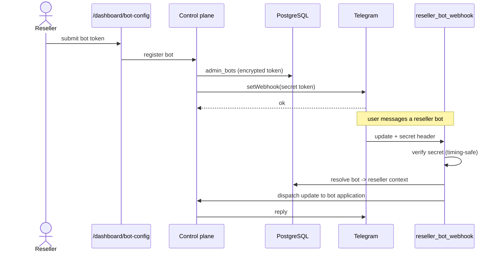
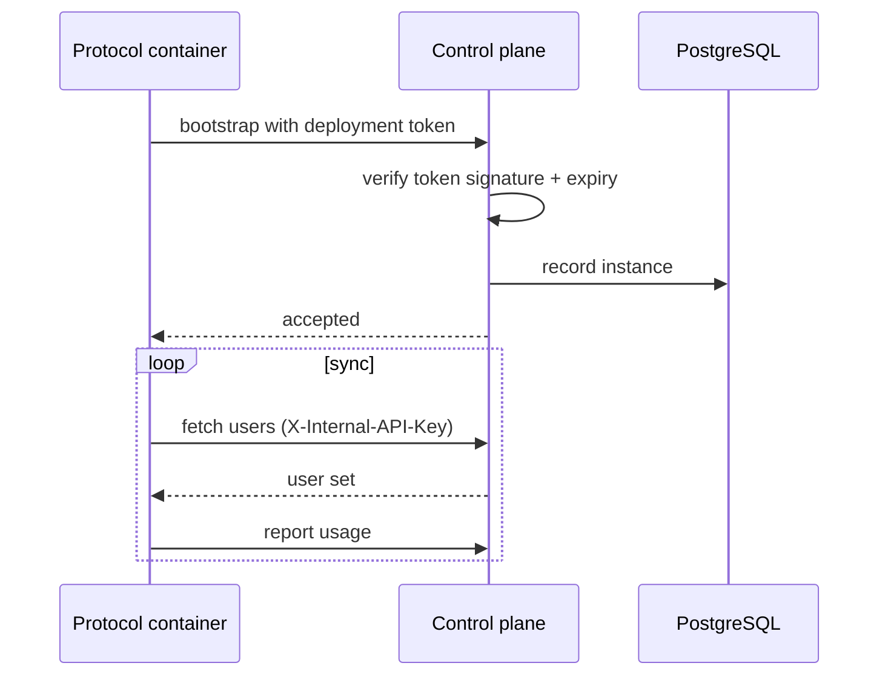

# Request flows

Sequence diagrams for the paths that matter most. Each one names the modules involved so
you can read the code alongside the diagram.

> These flows describe **intended source behaviour**. They are derived from reading the
> code, not from observing a running deployment.

## 1. End-user purchase and provisioning

Modules: `services/orders`, `services/subscriptions`, `services/credentials`,
`api/v1/endpoints/user_orders_api.py`, `api/v1/endpoints/internal_v2.py`, bot handlers in
[`telegram_bot/bot/handlers/`](../../telegram_bot/bot/handlers/).

Two properties are worth preserving: an order never provisions before approval, and
delivery is idempotent so a retried approval does not issue duplicate credentials.

## 2. Reseller wallet top-up (wire transfer)

Modules: `services/billing/wire_order_service.py`,
`services/billing/wallet_service.py`, `services/billing/conversion.py`.

Approval is the money-mutating step, so it must be safe to retry and must record who
approved what, at which rate, leaving an auditable entry rather than mutating a balance.

## 3. Free-config enrollment

Modules: `services/free_config/` (`policy.py`, `enrollment_service.py`,
`membership_verifier.py`, `global_service.py`), models `free_config_channel`,
`free_config_enrollment`, `free_config_global`.

Policy is evaluated server-side. Client-side checks are convenience only — never the
authority for quota or eligibility.

## 4. Domain and DNS synchronisation (FDM)

Modules: `services/fdm/` (`fdm_domain_service.py`, `fdm_sync_service.py`,
`dns_provider.py`, `arvancloud_client.py`, `cloudflare_client.py`, `liveness.py`,
`iran_reach.py`), `tasks/fdm_tasks.py`, `tasks/tld_analytics.py`.

Constraints that matter operationally: provider rate limits are shared across all
domains, so the sync skips already-converged records instead of rewriting everything each
cycle; and a mass liveness failure must not be interpreted as "delete everything" — the
dead-fraction guard exists for that reason.

## 5. Bot registration and webhook dispatch

Modules: `api/v1/endpoints/bot_config_api.py`,
`api/v1/endpoints/reseller_bot_webhook.py`, `services/bots/reseller_bot_manager.py`,
[`telegram_bot/bot/main.py`](../../telegram_bot/bot/main.py).

Bot tokens are stored encrypted (see
[`worker_api/app/core/crypto.py`](../../worker_api/app/core/crypto.py)) and are never
returned to the browser after registration. One webhook endpoint serves every reseller
bot, so routing must resolve the bot before any handler runs.

## 6. Node bootstrap

Modules: `services/auth/deployment_tokens.py`,
`api/v1/endpoints/internal_v2.py`,
[`integrations/base/entrypoint-wrapper.sh`](../../integrations/base/entrypoint-wrapper.sh).

A node that cannot bootstrap must not start its engine: unattributed traffic is worse than
downtime.

## Reading these critically

- Failure branches are summarised, not exhaustive; the code is the authority.
- No flow here has been executed end to end for this snapshot.
- Where a flow touches money or credentials, assume retries happen: idempotency is a
  requirement, not a nicety.