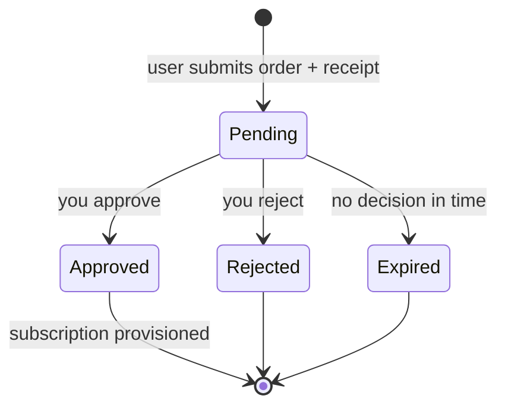

# Reseller Runbook

Everything a reseller does: getting approved, funding a wallet, running a Telegram bot,
selling packages, reviewing orders and managing end users.

> **Context.** This guide describes the reseller surfaces in this repository. Your
> operator supplies the deployment; you supply the commercial relationship with your end
> users. Where a step depends on an external service (Telegram, a payment gateway, a DNS
> provider), it is marked **unverified** because this snapshot ships no executed
> deployment.

**Naming note.** Internal identifiers and environment variables in this codebase retain
the historical `FLUXVPN_*` form. This project is independent and is not affiliated with,
endorsed by, or an official part of RunOnFlux or FluxCloud.

## Table of Contents

- [1. Concepts](#1-concepts)
- [2. Getting Started](#2-getting-started)
- [3. Wallet & Billing](#3-wallet--billing)
- [4. Your Telegram Bot & What End-Users See](#4-your-telegram-bot--what-end-users-see)
- [5. Packages, Orders & Referral](#5-packages-orders--referral)
- [6. Managing End-Users & Troubleshooting](#6-managing-end-users--troubleshooting)

## 1. Concepts

### What you are

You are a **reseller**: a tenant on someone else's platform. You buy capacity from the
operator, set your own prices, and serve your own end users. In the database your account
is an `Admin` record — confusingly, that is the reseller table, not the platform table.

| You control | The operator controls |
| --- | --- |
| Your packages, prices and quotas | Platform pricing and the domain your users connect through |
| Your end users and their subscriptions | Domain/DNS infrastructure |
| Your Telegram bot and its messages | Platform applications and node capacity |
| Your orders and approvals | Your wallet's credit after a wire top-up |

### Your USD wallet

Your wallet is a **prepaid ledger**, not a bank account with a mutable balance. Every
movement is an entry, and your balance is the sum of entries:

- **Credits** come from approved wire top-ups and adjustments.
- **Debits** come from usage (`debit_traffic`) and additional regions (`debit_region`).

Because it is a ledger, your history is auditable — and corrections appear as new entries
rather than edits. If you think a charge is wrong, ask the operator for an adjustment with
a reason; do not expect a balance to be silently rewritten.

### How your end-users pay you

Your end users pay **you**, not the platform. Typical flow:

1. An end user chooses a package in your bot or portal.
2. They pay you however you accept payment (bank transfer, card, crypto, cash).
3. They upload a receipt, or you mark the payment received.
4. **You** approve the order in `/dashboard/orders`.
5. Approval provisions the subscription and issues credentials.

The platform records the order; it does not take the money for you. That is why order
approval is yours and why your wallet must be funded independently.

## 2. Getting Started

### 2.1 How do I register a reseller account?

1. Open `/register` on your operator's dashboard.
2. Complete the registration form with your details and a strong password.
3. Submit and wait for approval.

Registration creates a **pending** reseller. You cannot log in to `/dashboard`, create end
users or register a bot until the operator approves you. If approval is taking long, ask
the operator — do not register a second account.

### 2.2 How do I log in after approval?

1. Open `/login`.
2. Sign in with the credentials you registered.
3. You land on `/dashboard`.

If login is rejected after approval, the likely causes are: the approval did not complete,
your password was changed by an operator-initiated reset, or the account is suspended.
Contact the operator rather than creating another account.

### 2.3 Dashboard tour

The dashboard is organised around what you do daily: watch your balance, watch your users,
and clear your order queue.

#### Wallet Balance card

The card at the top of `/dashboard` shows your **derived balance**: the sum of all ledger
entries. It is not a cached number, so it changes as charges land. A falling balance with
no new users means usage charges are running — check the transaction list before assuming
an error.

#### Stat cards

The stat cards summarise your account: active users, connections, and recent activity.
They are a snapshot for orientation, not a billing statement. Money questions belong in
the wallet view.

#### Top Users by Traffic

This table ranks your heaviest users by reported traffic. It is the fastest way to answer
"who is using all my capacity?" and the natural place to start when a package quota looks
wrong. Traffic figures come from node telemetry; a node that stops reporting will make its
users look idle.

#### Recent Transactions

The latest ledger entries with their type and amount. Use it to connect a balance change
to a cause. Anything you do not recognise should be raised with the operator with the
entry's date and amount.

#### Protocol Breakdown

Traffic split by protocol. Useful when one protocol dominates your costs, or when a user
reports a problem on a protocol you did not expect them to use.

#### Dashboard sidebar navigation

| Item | Goes to |
| --- | --- |
| Users | Your end-user list and detail pages |
| Wallet | Balance, ledger and wire top-up requests |
| Packages | The packages you sell |
| Orders | Pending and historical orders |
| Bot config | Your Telegram bot registration and settings |
| Referral | Invite links and earnings |
| Routing rules | Per-user routing configuration |
| Servers | Nodes/instances visible to you |
| IPs | Address pools assigned to you |
| Usage | Traffic and connection reporting |
| Support | Conversations with your end users |
| Help | This guide, in the app |

### 2.4 How do I change my password?

1. Open your account settings from the dashboard.
2. Enter your current password and the new one.
3. Save, then sign out and back in to confirm.

Changing your password does not change your bot token or your wallet. If you believe your
session was compromised, also ask the operator to review your account activity.

## 3. Wallet & Billing

### 3.1 How do I fund my wallet (wire top-up)?

A wire top-up is a manual transfer: you send money outside the platform and the operator
credits your wallet at an agreed rate.

1. Open `/dashboard/wallet` and start a top-up request.
2. Enter the amount and the payment reference you used.
3. Submit. The request appears as **pending**.
4. The operator verifies the funds arrived and approves at a rate.
5. Your balance increases by a **new credit entry**.

Practical notes:

- **The rate matters.** The credit is derived from the received amount and the applied
  rate. Approving at a stale rate is a real money difference, so confirm the rate with the
  operator when it is not obvious.
- **A pending request is not money.** Do not promise users capacity before the credit
  appears.
- **Never send funds without a reference.** An unmatched transfer is a support case, not a
  credit.

### 3.2 How do I understand my charges?

Charges are generated by background billing passes from usage data. Each one appears as a
ledger entry.

#### Traffic charges (`debit_traffic`)

Your users' reported traffic is charged against your wallet according to your agreement.
These entries are typically the majority of your spend and scale with usage rather than
user count. If a traffic charge looks wrong, compare it with the Top Users table and the
usage view for the same period.

#### Region charges (`debit_region`)

A user's first region is free of separate region billing. Each **additional** region gets
a billing clock, so the monthly per-region charge starts after the first month. That means
a user who spans several regions costs more than the same traffic in one region — a
pricing decision worth making deliberately.

#### Credits

Credits are approved top-ups and operator adjustments. They are always separate entries;
no charge is ever silently reduced.

### 3.3 What happens when my wallet runs dry?

Billing is prepaid in intent. When the balance cannot cover charges:

- charges may fail to apply, leaving usage unaccounted for,
- your users are at risk of losing service,
- the operator may suspend or contact you.

Treat a low balance as an operational alarm, not a warning light to ignore. Top up before
your busiest period rather than during it — approvals are manual and take time.

### 3.4 How do I read my transaction history?

Open `/dashboard/wallet` and review the entries. For each entry, check:

| Field | What to look for |
| --- | --- |
| Type | `debit_traffic`, `debit_region`, credit, adjustment |
| Amount | Whether it matches your expectation |
| Date | Whether it lines up with a usage spike or an approval |
| Reason | The operator's note on credits and adjustments |

If something is unexplained, collect the date and amount and raise it with the operator.
"It charged me too much" is not actionable; "entry 2026-11-03, 12.40 debit_traffic, but my
top users show almost no traffic" is.

## 4. Your Telegram Bot & What End-Users See

Your bot is the main storefront for most resellers. It is registered by you, carries your
token, and serves only your users.

### 4.1 Create a bot with @BotFather

1. In Telegram, message **@BotFather**.
2. Use `/newbot`, choose a display name and a username ending in `bot`.
3. Copy the token BotFather returns and keep it secret.
4. Optionally set a description and avatar so users recognise the bot.

Anyone with the token can impersonate your bot. Do not paste it into chats, tickets or
screenshots. If it leaks, revoke it in BotFather and register the new token.

### 4.2 How do I register my bot with the platform?

1. Open `/dashboard/bot-config`.
2. Paste the token and submit.
3. The platform stores the token **encrypted** and registers a webhook with Telegram.
4. Confirm the registration shows as active with a healthy webhook.

After registration the token is not displayed again. If you lose it, revoke it in BotFather
and register the replacement.

### 4.3 How do I verify the bot is working?

1. Message your bot from a Telegram account that is not your own admin account.
2. Send `/start` and confirm the welcome message and menu appear.
3. Open `/dashboard/bot-config` and check the webhook status is healthy.
4. If the webhook is failing, re-register — the registration includes setting the webhook.

A bot that responds to you but not to users usually means the webhook points at the wrong
host, or the deployment's public URL changed.

### 4.4 How do I update bot settings (without re-registering)?

Use `/dashboard/bot-config` to change messages, language and presentation. Updating
settings does not require a new token or a new webhook. Re-register only when the token
changes or the webhook breaks.

### 4.5 How do I deactivate and reactivate my bot?

#### Deactivate

Deactivating stops the bot serving your users. Do this when you are changing tokens,
pausing sales, or investigating abuse. Users who message a deactivated bot get no service.

#### Reactivate

Reactivate from the same screen. Then verify the webhook and send a test `/start` before
telling users the bot is back.

### 4.6 What your end-users experience - the bot journey

This is the flow your users see. It is worth walking through yourself before launch.

#### /start - auto-registration

A new user sends `/start` and is registered against your account automatically. They are
greeted and shown the main menu. No platform-level signup is involved.

#### Main menu

The menu is the entry point to buying, viewing a subscription, connections, support,
referral and settings. Labels follow the language you configured.

#### Buy flow (`buy` → `pkg:` → `region:` → receipt photo)

1. The user chooses **buy**.
2. They pick a package (`pkg:`).
3. They choose a region (`region:`).
4. They pay you and send a receipt photo.

The order then waits for **your** approval. Until you approve, the user has paid but has no
subscription — which is why order review is time-sensitive.

#### My Subscription (`my_sub` callback)

Shows the current subscription: package, expiry, quota and status. This is where a user
checks whether a renewal is due.

#### My Connections (`connections` callback)

Shows the connection details for the user's active subscription. This is the most
support-heavy screen: most "it does not work" reports start here.

#### Support (`support` callback)

Opens a conversation with you. Treat it as a real inbox: unanswered support is the main
reason users churn.

#### Referral (`referral` callback)

Shows the user's invite link and any earnings, when the referral program is enabled.

#### Settings (`settings` callback)

Language and personal preferences. Persian is right-to-left; check both languages before
launch.

#### Client setup guides (`guide:android`, `guide:ios`, `guide:windows`)

Step-by-step instructions per platform. These are the best defence against connection
support questions — point users here first.

### 4.7 What your end-users experience - the web portal

Some users prefer a browser. The portal shares the same account and credentials.

#### `/user/login` - Sign in

Users sign in with the credentials issued with their subscription.

#### `/user/connections` - Connection strings

The same connection details as the bot, in copyable form. Useful on desktop.

#### `/user/usage` - Bandwidth consumption

Traffic consumed in the current period. This is the user's view of what you are billed
for, so it should agree with your usage view.

#### `/user/guide` - Client setup guides

The same setup instructions as the bot's guide callbacks.

### 4.8 Troubleshooting: bot not responding

| Symptom | Check |
| --- | --- |
| No response at all | Bot registration active? Webhook healthy? |
| Responds to you, not to users | Webhook host reachable from the internet; public URL unchanged |
| Responds, but menus fail | Bot settings or language configuration |
| Receipt photo not received | Order stays pending; check the order view for the attachment |
| Users see another reseller's name | Wrong token registered — revoke and re-register |

## 5. Packages, Orders & Referral

### 5.1 Create and manage packages

#### 5.1.1 How do I create a package?

1. Open `/dashboard/packages` and start a new package.
2. Set the name, duration, quota and price.
3. Save and confirm it appears in the list and in the bot's buy menu.

Decide your quota and duration deliberately: a package with unlimited quota against a
metered wallet is a way to lose money quietly.

#### 5.1.2 How do I edit a package?

Edit an existing package to change its presentation or price. Existing subscriptions keep
the terms they were sold with; changes apply to new sales. If you need to change terms for
existing users, that is a deliberate migration, not an edit.

#### 5.1.3 How do I archive (deactivate) a package?

Archiving removes a package from sale without deleting its history. Do this instead of
deleting when you want to stop selling but keep the record of past orders. Existing
subscriptions continue.

#### 5.1.4 Package table columns explained

| Column | Meaning |
| --- | --- |
| Name | What users see in the buy menu |
| Duration | How long the subscription lasts |
| Quota | Traffic allowance before the subscription is exhausted |
| Price | What you charge your users |
| Status | Active or archived |
| Orders | How many orders reference it |

### 5.2 Review and approve orders

#### 5.2.1 How do I see my pending orders?

Open `/dashboard/orders` and filter to pending. Treat this as a queue to clear daily: every
pending order is a user who has paid and is waiting.

#### 5.2.2 How do I view a receipt and approve or reject an order?

1. Open the order from the queue.
2. Review the receipt against the amount you expected.
3. Approve to provision, or reject with a reason.

**Before approving:** the amount matches the package, the payment actually reached you,
and the user is not already covered by an active subscription.

#### 5.2.3 What happens when you approve - delivery details

Approval creates the subscription, issues credentials, and makes the connection details
available in the user's bot and portal. Approval is the provisioning step: nothing is
issued before it.

#### 5.2.4 How do I retry a failed receipt download?

If the receipt image fails to load, retry the download from the order view. A permanently
unreadable receipt means you cannot verify payment — reject with a reason and ask the user
to resend rather than approving on trust.

#### 5.2.5 Order lifecycle and auto-expiry

Pending orders do not wait forever. An order left undecided can expire, which is another
reason to clear the queue daily. An expired order is not a refund — settle that with the
user directly.

### 5.3 Run a referral program

#### 5.3.1 How do I enable the referral program?

Enable it in your dashboard settings when the feature is available on your deployment. The
program is feature-flagged: if the controls are absent, the operator has not enabled it.

#### 5.3.2 How end-users share their invite link

Each user gets a personal invite link, shown in the bot's referral screen. When someone
joins through it, the referrer is credited according to your program's rules. Ask users to
share the link, not screenshots of it.

#### 5.3.3 How do I view referral stats and earnings?

Open `/dashboard/referral` for invites, conversions and any earnings. Compare it with your
wallet ledger: referral bonuses appear as ledger entries, so the two views should agree.

#### 5.3.4 Referral FAQ

| Question | Answer |
| --- | --- |
| Can a user refer themselves? | The platform records the inviter from the link; self-referral is not a supported pattern |
| Do bonuses come from my wallet? | Yes — bonuses are your cost, appearing as ledger entries |
| Can I change the rules later? | New rules apply to new referrals; existing ones keep what they were granted |
| What if a referral is fraudulent? | Reject or suspend the account and raise it with the operator |

### 5.4 Troubleshooting: packages, orders, and referral

| Symptom | Check |
| --- | --- |
| Package missing from the bot | Package archived? Bot settings not saved? |
| Order stuck pending | Your queue; or the order expired and needs a new one |
| Approved but no credentials | Subscription creation failed — check the user's detail page |
| Referral not credited | Invite link not used, or program disabled |
| Duplicate charge on one order | Do not approve twice; raise it with the operator with both entry dates |

## 6. Managing End-Users & Troubleshooting

### 6.1 How do I create an end-user manually?

Create a user manually when someone pays you outside the normal flow — a corporate
onboarding, a replacement account, or a migration from another provider.

1. Open `/dashboard/users` and start a new user.
2. Enter their details and assign a package.
3. Save, then confirm credentials were issued and are visible in their detail page.

Manual creation bypasses order review, so you are the approval step. Be sure payment has
actually happened.

### 6.2 How do I edit a user's profile?

Open the user from `/dashboard/users` and edit their details. Changes to identity or
contact details are safe; changes to the subscription are commercial decisions and should
be deliberate.

#### 6.2.1 Reset a user's password from the detail page

1. Open the user's detail page.
2. Use the reset action.
3. Give the new password to the user through a channel you trust — not a public chat.

A reset invalidates the old password immediately. If the user is mid-session, they will be
signed out.

#### 6.2.2 View and manage subscription links

The detail page shows the user's connection details. You can copy or resend them. Treat
these as secrets: anyone holding them can use the subscription.

### 6.3 How do I view and refresh a user's connections?

#### What the page shows

The connections view lists the user's protocols and their current connection strings,
along with active connection counts where telemetry is available.

#### Refresh Connections

Refresh reissues credentials when a user reports a failure or suspects a leak. Reissuing
invalidates the old details, so tell the user before you do it.

#### Reset Password (from Connections page)

The same password reset as the detail page, available where you are already looking at the
user's access.

#### Send to Telegram

Sends the connection details to the user's Telegram account. Confirm the account is the
right one; sending credentials to the wrong chat is a disclosure.

### 6.4 How do I suspend, reactivate, or delete a user?

#### Suspend / Reactivate (toggle)

Suspension stops access while keeping the record and history. Use it for non-payment,
abuse, or a temporary hold. Reactivating restores access without reissuing credentials.

#### Delete

Deletion removes the user and ends their access. It is destructive and handled by the
platform's compliance deletion path, which respects a retention window. Prefer suspension
when you may need the history.

### 6.5 Understanding regions

A region is a geographic location users connect through. Your packages offer some set of
them.

- The user's **first** region carries no separate region billing.
- **Additional** regions start a billing clock after the first month.
- More regions mean more cost and more configuration surface.

If a user reports slow speeds, region choice is the first thing to check — a nearby region
usually beats a distant one regardless of protocol.

### 6.6 Troubleshooting: common end-user issues

| Report | First checks |
| --- | --- |
| "It does not connect" | Subscription active? Credentials current? Guide followed? Region reachable? |
| "It is slow" | Region choice, protocol, and the user's own network |
| "It stopped working" | Quota exhausted, subscription expired, or credentials reissued |
| "I paid but got nothing" | Order still pending in your queue |
| "Usage looks wrong" | Compare the user's usage view with your Top Users table |
| "I lost my connection details" | Resend from the user's detail page; do not create a second account |
| "The bot does not answer" | Bot registration and webhook health |

When a report is vague, ask for the specific screen and the exact error. "It does not
work" cannot be diagnosed; "the bot's My Connections screen shows an empty list" can.
