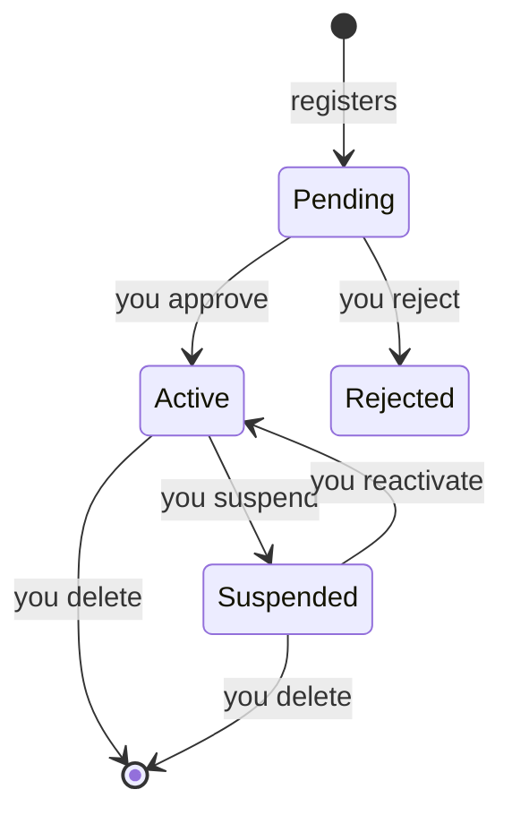

# Super-Admin Runbook

Platform-level operation of the control plane: resellers, pricing, wire top-ups, domains
and platform applications.

> **Scope.** This runbook describes the operator surfaces in this repository. It assumes
> you have already stood up an environment — see [Deployment](../DEPLOYMENT.md) for what
> that requires and [Configuration](../CONFIGURATION.md) for every setting referenced
> here. Steps that depend on a live third party are marked **unverified**, because this
> snapshot ships no executed deployment.

**Naming note.** Internal identifiers, environment variables and module names retain the
historical `FLUXVPN_*` form. This project is independent and is not affiliated with,
endorsed by, or an official part of RunOnFlux or FluxCloud.

## Table of Contents

- [1. Concepts](#1-concepts)
- [2. Logging In](#2-logging-in)
- [3. First-Run / Seeding a New Deployment](#3-first-run--seeding-a-new-deployment)
- [4. Managing Resellers](#4-managing-resellers)
- [5. Wire Orders & Platform Settings](#5-wire-orders--platform-settings)
- [6. TLD & DNS Management](#6-tld--dns-management)
- [7. Flux Apps, Bot Oversight, Analytics & Troubleshooting](#7-flux-apps-bot-oversight-analytics--troubleshooting)

## 1. Concepts

### The three actors

| Actor | Record | Surface | Can do |
| --- | --- | --- | --- |
| Super admin | `SuperAdmin` | `/super/*`, platform bot | Approve resellers, approve wire top-ups, set pricing, manage domains, register platform apps |
| Reseller | `Admin` | `/dashboard/*`, own bot | Sell packages, manage own end users, review own orders, fund a wallet |
| End user | `AdminUser` | Reseller bot, `/user/*` portal | Buy subscriptions, connect, view usage |

Two naming traps worth memorising: a reseller is an `Admin` record and an end user is an
`AdminUser` record. `super_admin` is a role claim, not a separate table.

### Reseller lifecycle



Only an approved reseller can sign in to `/dashboard`, register a bot, or create end
users. Suspension keeps data but stops service; deletion is destructive and should follow
your retention policy.

### The money model

- A reseller's wallet is a **ledger**: entries are appended and the balance is derived.
  Correct mistakes with a new adjustment entry, never by editing history.
- Resellers fund the wallet by **wire top-up**: they submit a request, you approve it at a
  chosen exchange rate, and a credit entry is written.
- Usage charges (`debit_traffic`) and additional-region charges (`debit_region`) are
  debits produced by background billing passes.
- End users pay the reseller outside the platform (receipt or gateway). Those payments
  create an **order** the reseller reviews; approving it provisions the subscription.

### Where you operate

| Task | Surface |
| --- | --- |
| Reseller approvals, platform settings, wire orders | `/super/*` dashboard, platform bot |
| Domains, DNS providers and TLDs | `/super/domains` |
| Platform applications and bot oversight | `/super/apps` |
| KPIs and deeper analytics | `/super/dashboard`, `/super/analytics` |

## 2. Logging In

### 2.1 How do I log in to the web dashboard?

1. Open `/super/login`.
2. Enter the super-admin username and password configured at first run
   (`SUPER_ADMIN_USERNAME` / `SUPER_ADMIN_PASSWORD`).
3. On success you land on `/super/dashboard`.

Sessions are JWT-based: access tokens are short-lived and refresh in the background. If
you are bounced straight back to the login page, suspect the token signing key or clock
drift.

**If you cannot log in at all:**

| Symptom | Check |
| --- | --- |
| Page loads, credentials rejected | The seeded super-admin record; the bootstrap password is only valid until first reset |
| Login succeeds, every page returns 403 | The account's role claim; re-seed if the record was altered |
| `502`/`504` from the dashboard | The dashboard's API proxy target (`API_PROXY_URL`, `NEXT_PUBLIC_API_URL`) |
| Endless redirect to `/super/login` | Clock drift, or a rotated `JWT_SECRET_KEY` — old tokens are invalid |

### 2.2 How do I use the Telegram platform bot?

The platform bot is your operator channel for approvals and oversight when you are away
from the dashboard.

1. Set `TELEGRAM_BOT_TOKEN` to the platform bot token.
2. Set `WEBHOOK_SECRET` to a value your deployment generates.
3. Register the webhook so Telegram can deliver updates to your API.
4. Link your own Telegram account so the bot recognises you as an operator (step 5 of
   first-run below).

The bot authenticates you by Telegram user identity. **Verify that link on a fresh
deployment before relying on the bot** — an unlinked operator sees nothing, and a wrongly
linked one is a privilege problem.

## 3. First-Run / Seeding a New Deployment

### Step 1 - Set env vars before first boot

Generate every value yourself; never reuse an example. At minimum:

| Variable | Notes |
| --- | --- |
| `DATABASE_URL` | PostgreSQL connection string |
| `REDIS_URL` | Redis connection string |
| `JWT_SECRET_KEY` | Signs sessions; rotating it logs everyone out |
| `FLUXVPN_SECRET_KEY` | Derives the key that encrypts stored bot tokens — rotation requires re-encryption |
| `INTERNAL_API_KEY` | Machine-to-machine key for nodes and the bot process |
| `SUPER_ADMIN_PASSWORD` | Bootstrap platform password |
| `TELEGRAM_BOT_TOKEN`, `WEBHOOK_SECRET` | Platform bot identity and webhook verification |
| `FLUX_WALLET_ADDRESS`, `FLUX_WALLET_PRIVATE_KEY` | Platform authorization identity (treat the key as a signing key) |
| `FLUXVPN_API_URL`, `PUBLIC_API_BASE_URL`, `API_PROXY_URL`, `NEXT_PUBLIC_API_URL` | How dashboard, nodes and the bot reach the API |
| `ALLOWED_ORIGINS` | Your real dashboard origins — never a wildcard |

Full inventory and explanations: [Configuration](../CONFIGURATION.md).

### Step 2 - Start the stack

The API container runs `alembic upgrade head` before serving, so the first start creates
the schema:

```bash
cd worker_api
./start.sh          # verifies imports, waits for the database, migrates, then serves
# or, for local development:
uvicorn app.main:app --reload --port 8080
```

Never enable `DEBUG` on an internet-reachable deployment: it turns on interactive API
documentation at `/api/docs` and verbose logging.

In production, prefer running migrations as their own controlled step with a verified
backup rather than leaving them to container start — see [Deployment](../DEPLOYMENT.md).

### Step 3 - Log in and change the password

1. Sign in at `/super/login` with the bootstrap credentials.
2. Go to `/super/settings` and change the super-admin password.
3. Confirm you can sign out and back in with the new password, and store it in your
   secret manager.

Treat the bootstrap password as compromised the moment it has existed in a chat message,
shell history or screenshot.

### Step 4 - Set DNS API keys and pricing

1. `/super/settings` — set platform pricing and the provider credentials your deployment
   uses (Cloudflare token and zone, ArvanCloud API key).
2. `/super/domains` — add the domain you intend to serve subscriptions from and activate
   it (see section 6).
3. Optionally enable domain automation and its safeguards (dead-fraction threshold, sync
   cadence) per [Configuration](../CONFIGURATION.md).

Scope DNS tokens tightly: a token that can edit every zone turns one bug into an outage.

### Step 5 - Link your Telegram account

1. Start a chat with your platform bot.
2. Follow its linking flow so the bot associates your Telegram user with the super-admin
   record.
3. Verify from the dashboard, then send a test action (for example, listing pending wire
   orders) to confirm the association.

Anything the bot can do for you, an attacker with a wrongly linked identity can do too.
Re-verify after any environment rebuild.

## 4. Managing Resellers

Reseller administration lives at `/super/admins`. The platform bot mirrors the most
important actions.

### 4.1 How do I approve a pending reseller?

1. Open `/super/admins` and filter to pending registrations.
2. Review the reseller's submitted details.
3. Approve to activate, or reject to decline.

Approval is what makes `/dashboard` reachable for that reseller. Rejections should include
a reason: rejection is not deletion, and a rejected registration should not linger
silently.

**Before you approve, decide:**

- Do you know who this is, or is the platform open to self-service registration?
- Does the reseller set its own prices for its own end users, or do you enforce a floor?
- Is the wallet funded, or will the first charges fail?

### 4.2 How do I view a reseller's detail?

Open the reseller from `/super/admins`. The detail view shows:

| Area | What it tells you |
| --- | --- |
| Identity and status | Who they are, active or suspended |
| Wallet | Derived balance and ledger entries |
| End users | Count and current state |
| Bot | Registration state and webhook health |
| Orders and packages | What they are selling and what is pending |

Use this before approving a wire top-up or a manual credit: the ledger explains why they
are asking.

### 4.3 How do I manually credit a reseller's wallet?

Use a manual credit only for genuine corrections, reimbursements or promotions.

1. Open the reseller's detail view.
2. Choose the wallet adjustment action.
3. Enter the amount and a reason.

The result is a **new ledger entry**, never a balance edit. That is deliberate: the reason
you can audit a wallet later is that history is append-only. Write a reason a stranger
would understand a year from now.

### 4.4 How do I suspend a reseller?

Suspending stops service without destroying data:

- the reseller can no longer sell or manage users,
- its bot stops serving its end users,
- data, ledger history and configuration are retained.

Suspend rather than delete when the intent is "stop now, decide later". Check whether the
reseller has active end-user subscriptions first; cutting off people who paid is a business
decision, not just a click.

### 4.5 How do I reactivate a suspended reseller?

Reactivate from the reseller's detail view. After reactivation, verify:

1. the reseller can sign in,
2. its bot is serving again (webhook status),
3. previously issued subscriptions still work.

### 4.6 How do I permanently delete a reseller?

Deletion is destructive and should be the end of a retention decision, not a shortcut.
Before deleting, be able to answer:

- Is the wallet balance zero, or are you writing off a credit?
- Are there active end users who would lose service without notice?
- Does your retention policy require keeping traffic and support records?

If records must be retained, delete on a schedule that matches policy rather than
immediately.

### 4.7 How do I delete a single end-user of a reseller?

From the reseller's detail view you can act on an individual end user. Deleting one user

1. revokes their access,
2. ends their subscription entitlements,

and is handled by the compliance deletion path
(`services/compliance/user_deletion.py`), which respects the configured retention window
(`USER_DELETION_RETENTION_DAYS`).

If a reseller asks you to delete a user, confirm which user. "The one who complained" is
not an identifier.

## 5. Wire Orders & Platform Settings

### 5.1 How do I approve a pending wire top-up?

A wire top-up is a manual payment: the reseller sends funds outside the platform and
submits a request; you confirm the funds arrived and credit the wallet at an agreed rate.

#### How exchange rate affects credit

The credit written to the wallet is derived from the received amount and the rate you
apply. Consequences:

- Applying a stale rate is a real money error, not a rounding detail.
- The rate you approve is recorded with the entry, which is why the reason field matters.
- If you are unsure of the rate, reject and ask rather than approving approximately.

#### Via the web dashboard

1. Open `/super/orders`.
2. Open the pending wire top-up and verify the submitted reference against the funds
   actually received.
3. Enter or confirm the rate and approve.

**Before approving:** funds received, reference matches, amount matches, and the reseller
is not suspended.

#### Via the Telegram platform bot

The platform bot exposes the same approval action for mobile use. The same checks apply —
the bot makes approval *convenient*, not *casual*. If you cannot verify the funds from
where you are, wait until you can.

### 5.2 How do I reject a wire top-up?

Reject when the reference cannot be matched, the amount is wrong, or you suspect fraud.
Rejecting writes no credit and leaves a visible decision, which is better than leaving a
request pending indefinitely.

#### Via the web dashboard

1. Open `/super/orders` and the pending request.
2. Choose reject and give a reason.

#### Via the Telegram platform bot

Same action from the bot. Include a reason so the reseller knows what to fix.

### 5.3 How do I set platform pricing?

1. Open `/super/settings`.
2. Set the platform-level pricing and defaults that resellers' plans are based on.
3. Save, then verify from a reseller's perspective: the prices a reseller sees should
   match what you just set.

Pricing changes affect **new** charges. Existing subscriptions and historical entries keep
the values they were created with unless you adjust them deliberately.

### 5.4 How do I set DNS provider API keys?

1. Open `/super/settings` (or `/super/domains` for provider-specific configuration).
2. Enter the Cloudflare token and zone, and/or the ArvanCloud API key.
3. Save, then verify by listing existing zones or records from the domains screen.

A key that "saves successfully" has not been proven to work. Verify with a real read
against the provider before relying on automated DNS.

### 5.5 How do I change my super-admin password?

1. Open `/super/settings`.
2. Change the password and confirm.
3. Verify the new password by signing out and in again.
4. Update your secret manager, and revoke any session you no longer control.

Changing a password does not rotate `JWT_SECRET_KEY`. If you believe tokens were
compromised, rotate that secret too — doing so logs out every user.

## 6. TLD & DNS Management

### Concepts

| Term | Meaning |
| --- | --- |
| TLD | A zone used to serve subscriptions; recorded as `RegisteredTld` |
| Provider | A DNS vendor implementing the provider interface (Cloudflare, ArvanCloud) |
| Convergent sync | Reconciliation that skips records already in the desired state, protecting shared provider rate limits |
| Liveness | Whether a record resolves and the target answers at all |
| Reachability | Whether a target is usable from a particular vantage point |
| Dead fraction guard | Threshold that stops mass deletion when a large share of records look dead — usually a monitoring failure, not a real outage |

### 6.1 How do I add a new TLD?

1. Open `/super/domains`.
2. Add the domain, selecting the provider that owns the zone.
3. Confirm the provider credentials are configured (section 5.4) before saving.
4. Run a sync and verify the expected records appear at the provider.

Adding a TLD does not by itself serve traffic: activation is a separate step so a
half-configured zone cannot take customers.

### 6.2 How do I activate a TLD?

Activate the TLD from `/super/domains`. Activation makes the zone eligible for
subscription delivery and for automated DNS reconciliation.

Before activating, confirm the zone resolves and the provider credentials are correct. An
active TLD with broken credentials produces failed deployments rather than a clear error.

### 6.3 How do I deactivate a TLD?

Deactivate from `/super/domains`. Deactivation stops new assignments to the zone while
keeping its configuration and history.

Check whether resellers are pinned to it (section 6.5) and whether active subscriptions
depend on it. Deactivation is reversible; deletion is not.

### 6.4 How do I delete a TLD?

Deletion removes the zone's configuration. Before deleting:

- confirm no reseller is pinned to it,
- confirm no active subscription depends on it,
- decide whether DNS records at the provider should be cleaned up first.

Deleting the platform record does not necessarily delete provider records — clean up at
the provider deliberately, or you leave dangling DNS pointing at retired nodes.

### 6.5 How do I pin a reseller to a specific TLD?

Pinning assigns a reseller to a chosen zone so its users are served from that zone rather
than the general pool. Use it when a reseller has a domain-specific requirement or a
branding commitment.

Remember the operational cost: a pinned reseller is affected by that zone's outages
specifically. Document the pin, so a future outage is diagnosable.

### 6.6 How do I read TLD analytics?

Per-TLD daily rollups are produced by the analytics task and stored in `tld_usage_daily`,
surfaced at `/super/domains` and in `/super/analytics`.

Read them as trends, not absolutes: a sudden drop in a zone usually means either a real
outage or a telemetry failure. Check node health before concluding the zone is failing.

### 6.7 How do I diagnose a DNS-dark TLD?

When a zone stops resolving or its records disappear:

1. **Check the provider first.** Credentials, quota and provider status explain most
   incidents. An expired token looks exactly like a zone-wide outage.
2. **Check the dead-fraction guard.** If the automation believed most records were dead, it
   may have refused to act. That guard is protecting you from deleting a working zone.
3. **Check liveness versus reachability.** A record can be live but unreachable from a
   specific network; that is a routing problem, not a DNS problem.
4. **Check the sync log.** Convergent sync skips converged records, so "nothing happened"
   is often the correct outcome.
5. **Only then re-run the sync.** Re-running a sync against a provider with wrong
   credentials can make things worse, not better.

## 7. Flux Apps, Bot Oversight, Analytics & Troubleshooting

### 7.1 Concepts

| Term | Meaning |
| --- | --- |
| Platform application | A deployment unit on RunOnFlux/FluxCloud; recorded as `flux_app_registration` |
| Application specification | The declarative description (image, ports, resources, environment) sent to the platform |
| Instance | One running container discovered for an application |
| Consensus | Cross-checking an answer from multiple nodes before trusting it |
| Circuit breaker | Failure-threshold mechanism that stops hammering a failing dependency |

This project is independent of RunOnFlux. See
[../architecture/flux-platform.md](../architecture/flux-platform.md) for how the
integration works.

### 7.2 How do I register a new Flux app?

1. Open `/super/apps`.
2. Register the application with an explicit specification: image, ports, resources and
   environment. Nothing is inferred for you.
3. Save, then sync to discover instances.

**Never put a secret in the specification.** Values placed there are visible to the
platform and to anyone with access to the registration record. Use the application's own
environment configuration instead.

### 7.3 How do I sync / edit / activate / delete a Flux app?

#### Sync - discover running instances

Sync asks the platform which instances actually exist and updates the local record. Run it
after any deployment change. Discovery is cached; a stale cache explains "the app is
running but the platform cannot see it".

#### Edit - update ports or toggle active status

Editing changes the recorded specification or the active flag. Editing is not deployment:
changing the record does not redeploy anything by itself. Treat a spec change as a change
that needs a deployment and a verification step.

#### Delete - permanently remove an app

Deletion removes the platform record. It does not necessarily stop instances that are
already running, and it does not clean up DNS. Remove the app deliberately and confirm the
instances are gone.

### 7.4 How do I oversee reseller bots platform-wide?

#### List all reseller bots

`/super/apps` and the bot oversight view list registered reseller bots with their status
and webhook health. This is your fastest way to answer "is this reseller's bot alive?"

#### Check a single bot's webhook status

A bot receives messages only while its webhook is registered and Telegram accepts it. A
bot whose webhook is broken looks "online" in the dashboard but never answers users. Check
the webhook status before debugging anything else.

#### Re-register all bot webhooks after a domain migration

After changing the API domain, every bot's webhook still points at the old host. Re-register
them all from the oversight view. Until you do, no reseller bot receives updates — and the
failure is silent from the reseller's side.

### 7.5 How do I read platform analytics?

#### `/super/dashboard` - operational KPIs

The dashboard shows the current operating picture: reseller counts, active users, traffic
volume, revenue-relevant totals and platform health signals. Use it for "is anything wrong
right now?".

#### `/super/analytics` - deeper analytics

The analytics view goes deeper: usage trends, per-domain performance, protocol breakdown
and period comparisons. Use it for "what changed and why?".

Both read from the same counters that billing uses. If analytics looks wrong, billing is
probably wrong too — investigate the telemetry path, not the chart.

### 7.6 Troubleshooting / FAQ

**Nothing works and I do not know where to start.**
Check in this order: database reachable, Redis reachable, API healthy, dashboard proxy
correct, then application-level configuration. Most "everything is broken" reports are a
single dependency outage.

**Approvals appear to succeed but nothing changes.**
Check the background workers. Approval endpoints write state; workers do the follow-up
work. A dead worker queue looks like a silent failure.

**A reseller says their wallet is wrong.**
Read the ledger, not the balance. Every entry has a reason and a timestamp. If an entry is
genuinely wrong, add a corrective adjustment — do not delete history.

**A domain stopped working after a sync.**
Section 6.7. Check provider credentials and the dead-fraction guard before re-running
anything.

**A reseller's bot stopped responding.**
Section 7.4. Check webhook status first; the most common cause is a domain change without
re-registration.

**I rotated `FLUXVPN_SECRET_KEY` and bot tokens stopped decrypting.**
That key derives the encryption key for stored bot tokens. Rotation without re-encryption
breaks decryption. Restore the previous key, then migrate deliberately.

**Can I run this without the RunOnFlux integration?**
The protocol layer can run on any infrastructure you operate. The platform integration is
what deploys and discovers nodes; without it you must provision nodes yourself.

**Is this production-ready?**
No. Nothing in this snapshot has been installed, migrated or load-tested. See
[Deployment](../DEPLOYMENT.md) and [Capabilities](../FEATURES.md).